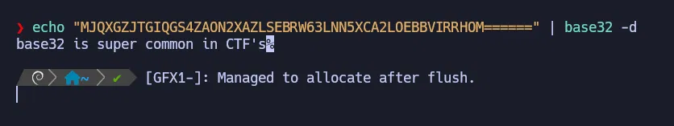
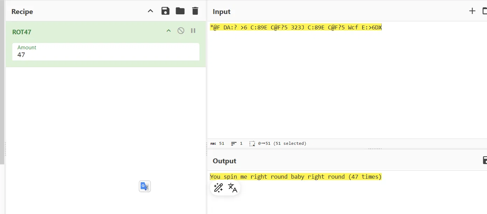
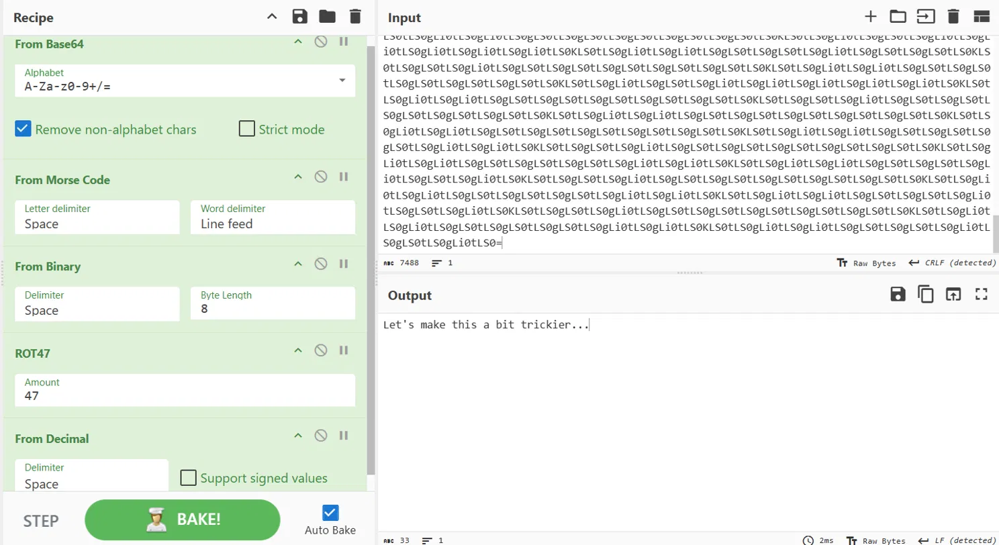
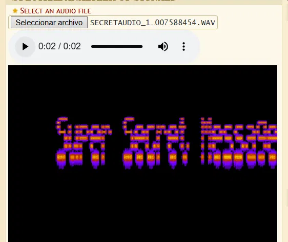
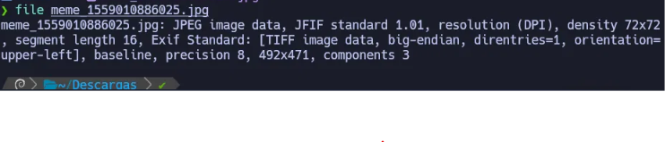
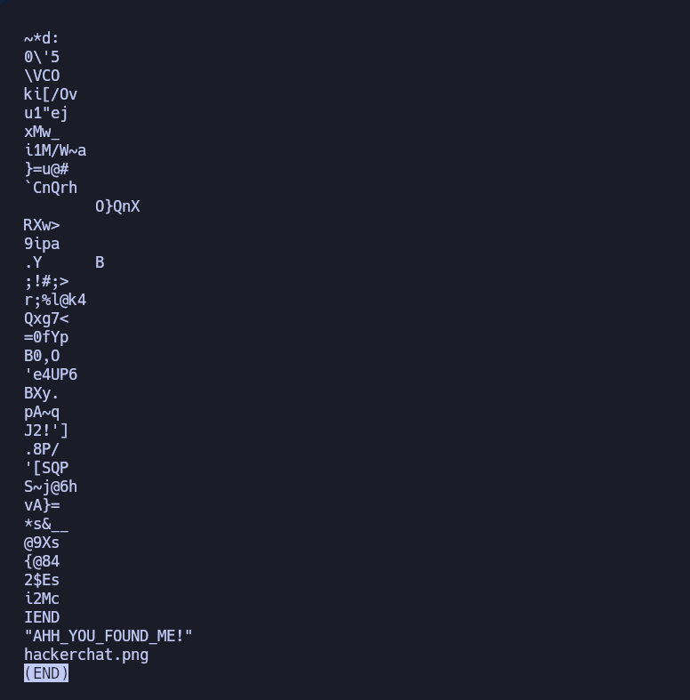

# C4ptur3-th3-Fl4g — TryHackMe (Fácil)

**Plataforma:** TryHackMe · **Categoría:** Criptografía / Esteganografía · **Herramientas:** CyberChef, terminal, dcode.fr, futureboy.us, strings

---

## Resumen

Room sin máquina objetivo. El foco es aprender a identificar y decodificar encodings clásicos de CTF (binario, Base32, Base64, hex, ROT13, ROT47, morse, decimal) y técnicas de esteganografía (espectrograma en audio, LSB en imágenes, archivo escondido dentro de otro archivo). No hay explotación ni escalada de privilegios — el objetivo es reconocer datos ofuscados y extraer la información oculta.

---

## Habilidades demostradas

- Identificación y decodificación de encodings clásicos de CTF
- Decodificación multi-capa encadenada en CyberChef
- Análisis de espectrograma en archivos de audio
- Extracción de datos ocultos con steghide (vía herramienta online)
- Detección de archivos embebidos dentro de imágenes con `strings`
- Análisis forense básico de archivos con `file`

---

## 1. Encodings

La Task 1 cubre 8 encodings distintos. La lógica es siempre la misma: identificar el tipo por su forma visual y aplicar la decodificación correcta.

| Encoding | Pista visual | Herramienta |
|---|---|---|
| Binario | Solo 0s y 1s en grupos de 8 | CyberChef - From Binary |
| Base32 | Mayúsculas + `======` al final | `base32 -d` |
| Base64 | Mayúsculas/minúsculas + `==` al final | `base64 -d` |
| Hexadecimal | Grupos de 2 chars 0-9/a-f | `xxd -r -p` |
| ROT13 | Texto casi legible, letras desplazadas | CyberChef - ROT13 |
| ROT47 | Símbolos y números también desplazados | CyberChef - ROT47 |
| Morse | Puntos y rayas | CyberChef - From Morse Code |
| Decimal | Números separados por espacios (32-126) | CyberChef - From Charcode |

Para los que se hacen en terminal:

```bash
echo "CADENA======" | base32 -d
echo "CADENA==" | base64 -d
echo "68 65 78" | xxd -r -p
# ROT13 — CyberChef
```

Ejemplo de Base32 en terminal y ROT47 en CyberChef:





---

### Multi-layer encoding

La cadena estaba codificada en múltiples capas apiladas. Fui probando hasta descubrir el orden correcto: **Base64 → Morse → Binario → ROT47 → Decimal**. Todo en una sola receta en CyberChef.



---

## 2. Espectrograma

Me dieron un archivo `.WAV`. El mensaje no está en el audio que escuchas sino en la **visualización del espectrograma** — una representación gráfica de las frecuencias del audio a lo largo del tiempo.

Usé [dcode.fr/spectral-analysis](https://www.dcode.fr/spectral-analysis) para visualizarlo y el texto apareció directamente en la imagen.



---

## 3. Esteganografía (LSB)

Me dieron una imagen con datos ocultos mediante **steghide**, que usa el algoritmo LSB (Least Significant Bit) para esconder información en los píxeles sin cambio visual perceptible.

No pude instalar steghide en Parrot OS por problemas de dependencias, así que usé la herramienta online [futureboy.us/stegano/decinput.html](https://futureboy.us/stegano/decinput.html) como alternativa.

```bash
# Comando que se usaría con steghide instalado:
steghide extract -sf ARCHIVO.jpg
```

---

## 4. Security through obscurity (file-in-file)

Me dieron un archivo `meme_1559010886025.jpg`. Primero verifiqué su tipo real:

```bash
file meme_1559010886025.jpg
```



Intenté renombrarlo a `.zip` y descomprimirlo, pero falló. Usé `strings` para extraer texto legible del binario:

```bash
strings meme_1559010886025.jpg | tail -20
```

Al final del output aparecieron el nombre de un archivo PNG escondido dentro del JPEG y un mensaje oculto.



La técnica se llama **file-in-file** o **polyglot**: un archivo válido que al mismo tiempo contiene otro archivo embebido. La ocultación depende de que nadie piense en buscar adentro.

---

## Lo que probé y no funcionó

- Intenté instalar steghide y binwalk en Parrot OS — ambos fallaron por dependencias faltantes en los repos (`libevent-2.1-6`, `libtirpc1`). Tuve que recurrir a herramientas online como alternativa.
- Intenté descomprimir el JPEG renombrándolo a `.zip` — falló porque el archivo no tiene estructura ZIP, solo tiene bytes de otro archivo embebidos al final.
- binwalk lanzaba `AttributeError: module 'capstone' has no attribute 'CS_ARCH_ARM64'` — conflicto de versión del módulo capstone en Python.

---

## Perspectiva defensiva

Este room deja clara una lección importante:

Esconder datos en Base64 o dentro de una imagen no protege nada — cualquier analista con CyberChef o `strings` lo descubre en segundos. Estas técnicas son útiles para un atacante que quiere exfiltrar datos sin levantar sospechas en un firewall que solo inspecciona texto plano, pero no sirven como método de protección.


---

## Lecciones aprendidas

- Aprendí a reconocer encodings por su forma visual sin necesitar una herramienta — el patrón de `======`, los grupos de 0s y 1s o los puntos y rayas son suficientes.
- CyberChef permite encadenar operaciones: cuando un encoding da basura, agregar otra capa encima suele ser la respuesta.
- `strings` es una herramienta de análisis forense subestimada — sin instalar nada extra, revela lo que hay dentro de cualquier binario.
- La diferencia entre espectrograma y LSB: el espectrograma esconde el mensaje en la forma visual de las frecuencias de audio; LSB lo esconde en los bits menos significativos de los píxeles de una imagen.

---

## Referencias

- [CyberChef](https://gchq.github.io/CyberChef)
- [dcode.fr - Spectral Analysis](https://www.dcode.fr/spectral-analysis)
- [FutureBoy Steganography](https://futureboy.us/stegano/decinput.html)
- [AperiSolve](https://www.aperisolve.com)