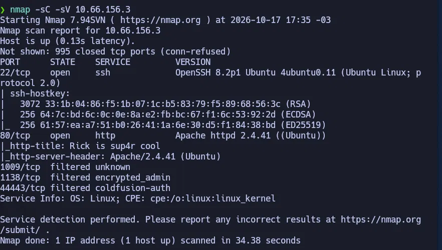
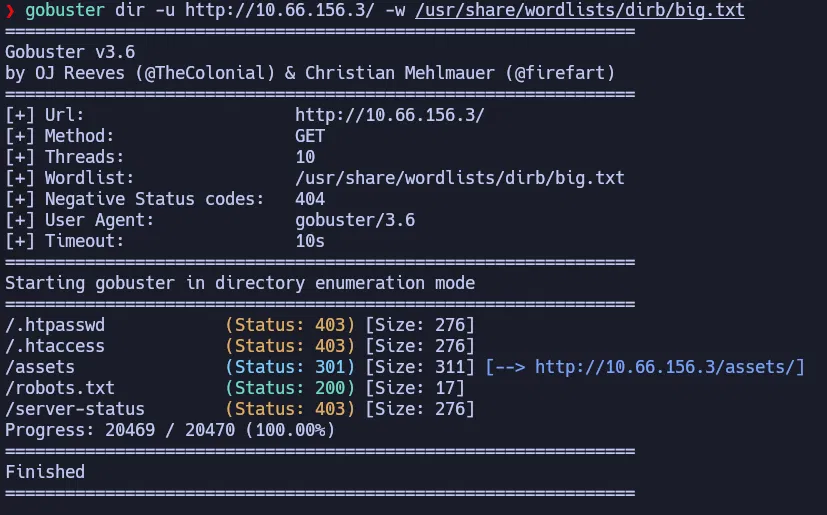
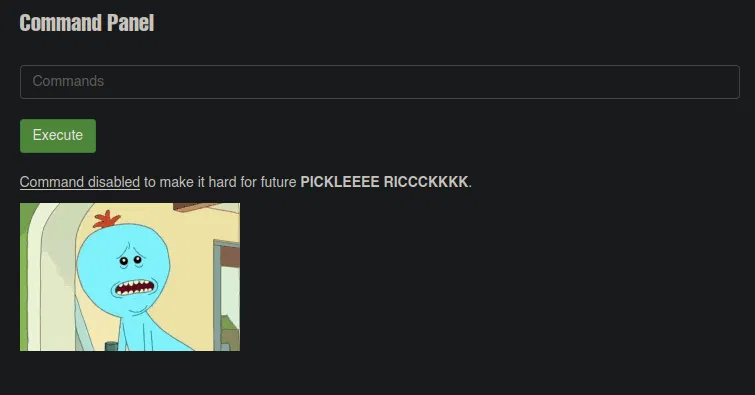
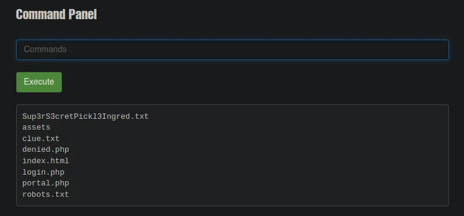
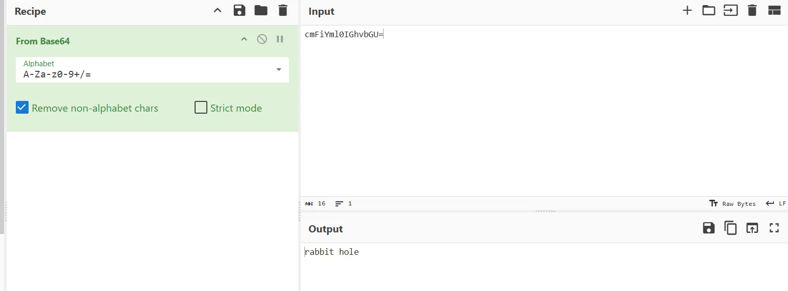

# Pickle Rick — TryHackMe (Fácil)

**Plataforma:** TryHackMe · **Categoría:** Reconocimiento web / Análisis de código fuente / RCE / PrivEsc · **Herramientas:** Nmap, Gobuster, curl, CyberChef, navegador web

---

## Resumen

Máquina Linux temática de Rick and Morty con foco completamente web. Las credenciales de acceso están expuestas en el código fuente de la página principal y en `robots.txt`. Con ellas se accede a un panel de administración con ejecución remota de comandos (RCE), que permite explorar el sistema de archivos y encontrar los tres ingredientes ocultos. El usuario del servidor web tiene permisos de sudo irrestrictos, lo que convierte cualquier exploración en acceso root de facto.

---

## Habilidades demostradas

- Escaneo de puertos y detección de servicios con Nmap (`-sC -sV`)
- Enumeración de directorios web con Gobuster
- Análisis de código fuente HTML para extraer credenciales expuestas en comentarios
- Lectura de `robots.txt` como fuente de información sensible
- Identificación y explotación de RCE mediante panel de comandos inseguro
- Evasión de filtros de lista negra usando comandos alternativos (`less`, `tac`, `grep`)
- Escalada de privilegios mediante `sudo (ALL) NOPASSWD: ALL`
- Reconocimiento de rabbit holes (distractores intencionales) en CTFs

---

## 1. Reconocimiento

```bash
nmap -sC -sV <IP>
```



| Puerto | Servicio | Versión |
|--------|----------|---------|
| 22     | SSH      | OpenSSH 8.2p1 Ubuntu |
| 80     | HTTP     | Apache 2.4.41 (Ubuntu) |

El título HTTP `Rick is sup4r cool` es una pista temática. El servidor SSH rechaza autenticación por contraseña (`Permission denied (publickey)`), por lo que el vector principal es el servicio web en el puerto 80.

---

## 2. Enumeración web

### Código fuente de la página principal

La página principal mostraba un mensaje narrativo sin información técnica visible. El código fuente (`Ctrl+U`) contenía un comentario HTML con una credencial:

```html
<!-- Note to self, remember username! Username: R1ckRul3s -->
```

Los comentarios HTML son completamente invisibles en el navegador pero visibles para cualquiera que inspeccione el código fuente. Práctica de seguridad deficiente muy común en aplicaciones web mal desarrolladas.

### robots.txt

```bash
curl -s http://<IP>/robots.txt
```

El archivo contenía una sola palabra que resultó ser la contraseña del panel de administración. `robots.txt` es un archivo público — cualquier dato incluido ahí es accesible para cualquier visitante, no solo para buscadores.

### Gobuster

```bash
gobuster dir -u http://<IP>/ -w /usr/share/wordlists/dirb/big.txt
```



Gobuster encontró `/assets` y `/robots.txt`, pero **no encontró `login.php` ni `portal.php`**. La razón no es que las palabras "login" y "portal" no estén en la lista — están en `big.txt`. El problema es que Gobuster, por defecto, busca rutas sin extensión. Para encontrar archivos `.php` hay que agregar `-x php`:

```bash
gobuster dir -u http://<IP>/ -w /usr/share/wordlists/dirb/big.txt -x php
```

No usé `-x php` en este escaneo, así que los archivos PHP no aparecieron. Los encontré navegando manualmente a rutas comunes. **Lección real: siempre incluir `-x` con las extensiones del stack objetivo.**

---

## 3. Acceso al panel de comandos

Con las credenciales obtenidas:
- **Usuario:** `R1ckRul3s` (del comentario HTML)
- **Contraseña:** (de `robots.txt`)

Acceso a `http://<IP>/login.php`, que redirige a `http://<IP>/portal.php` tras autenticarse.

El portal expone un **Command Panel**: un campo de texto con un botón "Execute" que envía comandos al servidor vía POST y muestra el resultado en la página. Esto es RCE directa — cualquier comando Linux válido se ejecuta en el servidor con los permisos del proceso web (`www-data`).

### Verificación del nivel de acceso

```bash
sudo -l
```

Resultado: `(ALL) NOPASSWD: ALL`

`www-data` puede ejecutar **cualquier comando como cualquier usuario**, incluyendo root, sin contraseña. Es la configuración de sudo más permisiva posible.

### Comandos bloqueados

El panel tiene una lista negra que bloquea ciertos comandos, incluyendo `cat`:



Los filtros de lista negra son inherentemente eludibles porque es imposible bloquear todos los comandos equivalentes. Alternativas funcionales:

```bash
less <archivo>
tac <archivo>
grep . <archivo>
```

---

## 4. Ingrediente 1

```bash
ls
```



Se encontró `Sup3rS3cretPickl3Ingred.txt` en el directorio raíz del servidor web. Lectura con alternativa a `cat`:

```bash
less Sup3rS3cretPickl3Ingred.txt
```

También se encontró `clue.txt`, cuyo contenido indicaba buscar en el sistema de archivos para los ingredientes restantes.

---

## 5. Ingrediente 2

```bash
sudo find / -name "*ingredient*" 2>/dev/null
```

Se encontró el archivo `/home/rick/second ingredients` (nombre con espacio incluido). Las comillas son necesarias para que la shell lo interprete como un único argumento:

```bash
sudo less "/home/rick/second ingredients"
```

### Distractor: rabbit hole en el código fuente del portal

El código fuente de `portal.php` contenía un comentario con una cadena codificada en base64. Tras decodificarla **7 veces** consecutivas en CyberChef:



El resultado fue `rabbit hole` — pista intencional del creador de la sala indicando que ese camino era un distractor. Técnica común en CTFs para consumir tiempo del atacante.

---

## 6. Ingrediente 3

El tercer ingrediente estaba en la carpeta de root, accesible gracias a los permisos de sudo irrestrictos:

```bash
sudo ls /root
sudo less /root/3rd.txt
```

---

## Lo que probé y no funcionó

- **SSH con las credenciales del comentario HTML**: el servidor rechaza autenticación por contraseña (`Permission denied (publickey)`). SSH estaba activo pero no era el vector.
- **Gobuster sin `-x php`**: usé `big.txt` sin especificar extensiones. "login" y "portal" sí están en la lista, pero Gobuster busca rutas sin extensión por defecto — `login.php` no aparece si no se pasa `-x php`. Error de flags, no de wordlist.
- **Rabbit hole de base64**: el comentario en `portal.php` con cadena base64 parecía una pista. Decodificar 7 veces en CyberChef devolvió `rabbit hole` — distractor intencional.

---

## Impacto

Un atacante sin credenciales puede comprometer el servidor completo desde la red leyendo el código fuente HTML y `robots.txt`, y descubriendo la página de login (navegación manual o Gobuster con `-x php`). Ambas fuentes son accesibles públicamente sin autenticación. Desde el panel RCE, `www-data` tiene sudo ilimitado, lo que equivale a root inmediato. No se necesita ninguna CVE, exploit ni código personalizado.

---

## Perspectiva defensiva

- **Nunca incluir credenciales en comentarios HTML ni en `robots.txt`**: ambos son archivos públicos. Un comentario HTML invisible en el navegador es visible para cualquier visitante que revise el código fuente.
- **`sudo (ALL) NOPASSWD: ALL` es la configuración más peligrosa posible**: equivale a dar acceso root completo sin autenticación a cualquier proceso que corra con ese usuario. Aplicar principio de mínimo privilegio.
- **Proteger paneles de administración con autenticación multifactor** y no exponerlos en rutas predecibles.

---

## Lecciones aprendidas

- El código fuente HTML y `robots.txt` son las primeras cosas a revisar en cualquier servidor web — revelan información que el navegador oculta visualmente.
- Gobuster requiere `-x` para encontrar archivos con extensión: `login.php` no aparece aunque "login" esté en la lista, a menos que se pase `-x php`. Siempre incluir las extensiones del stack objetivo (`-x php`, `-x php,txt`, etc.).
- Los filtros de lista negra son un control de seguridad débil. `less`, `tac` y `grep .` son equivalentes funcionales de `cat` que evitan filtros simples.
- Reconocer un rabbit hole a tiempo ahorra esfuerzo: si una pista parece demasiado elaborada sin resultados concretos, considerar que sea intencional.
- `sudo (ALL) NOPASSWD: ALL` en un usuario de servidor web es acceso root inmediato para cualquier atacante que comprometa ese proceso.

---

## Referencias

- [TryHackMe — Pickle Rick](https://tryhackme.com/room/picklerick)
- [OWASP — Command Injection](https://owasp.org/www-community/attacks/Command_Injection)
- [GTFOBins](https://gtfobins.github.io/)