# Gestión de Vulnerabilidades — TryHackMe (Media)

**Plataforma:** TryHackMe · **Categoría:** Gestión de Vulnerabilidades · **Rooms:** Nessus, OpenVAS, Vulnerability Scanning Tools · **Herramientas:** Nessus Essentials, OpenVAS/Greenbone (GVM), Nmap (+ NSE), Nikto, Docker

---

## Resumen

Fase de gestión de vulnerabilidades dentro de mi roadmap de ciberseguridad, cubriendo tres rooms de TryHackMe en un solo write-up porque las tres trabajan sobre el mismo flujo: **descubrir superficie de ataque → escanear → interpretar resultados → priorizar**. En vez de instalar y correr una sola herramienta, el objetivo fue comparar cuatro scanners distintos (Nessus, OpenVAS, Nmap y Nikto) contra los mismos tipos de objetivos (un host local, DVWA, y una aplicación web ficticia llamada AtlasNews), entendiendo qué detecta cada uno, dónde se solapan, y dónde cada herramienta tiene un rol claramente distinto dentro de un pipeline de seguridad real.

Esta fase conecta directamente con el tema de mi tesis: un motor de priorización de vulnerabilidades basado en CVSS, EPSS y grafos de dependencia. Todas las herramientas usadas acá son, en el fondo, generadoras de la materia prima (hallazgos, CVEs, CVSS scores) que ese tipo de motor necesita consumir para decidir qué vulnerabilidad atacar primero.

---

## Habilidades demostradas

- Instalación y configuración de Nessus Essentials en Linux (Debian/Parrot), incluyendo troubleshooting de compilación de plugins
- Diseño de scans de red con Nessus: templates, port scanning (all ports vs. common ports), tuning de ancho de banda para VPN
- Instalación de OpenVAS/GVM vía Docker sobre Parrot, resolviendo un conflicto real entre Podman (paquete por defecto de Parrot) y Docker Engine
- Comprensión de la arquitectura GVM: Front-End (GSA), Back-End (OSP/scanner), Feed de NVTs/SCAP
- Configuración de Targets, Tasks, Schedules y Alerts en OpenVAS para automatizar reescaneos y notificaciones
- Análisis de un caso práctico de gestión de vulnerabilidades estilo SOC (identificación de MS17-010 en un reporte pre-generado)
- Reconocimiento de red con Nmap: host discovery, detección de versiones de servicio, scan agresivo (OS detection, traceroute, NSE)
- Uso dirigido del Nmap Scripting Engine (NSE) para pruebas puntuales (ej. `ftp-anon`)
- Escaneo de servidores web con Nikto: disclosure de versión, headers de seguridad faltantes, exposición de archivos sensibles, detección de RFI
- Troubleshooting real de entorno: gestión de paquetes en Debian/apt, conflictos de dependencias, remoción/instalación forzada de paquetes, administración de contenedores Docker

---

## Metodología de trabajo

Cada herramienta se usó contra un objetivo distinto, siguiendo siempre la misma lógica de **ir de lo menos a lo más intrusivo** antes de sacar conclusiones:

| Herramienta | Objetivo escaneado | Tipo de scanner |
|---|---|---|
| Nessus | Servidor web de la room (Apache/Ubuntu) | Infraestructura / red |
| OpenVAS (instalación propia) | `127.0.0.1` (validación) → DVWA | Infraestructura / red |
| Nmap | Máquina de la room (FTP, SSH, HTTP, VNC, Apache) | Infraestructura / red |
| Nikto | AtlasNews (Apache 8080) | Servidor web |
| OpenVAS (pre-instalado en la room) | Reporte "MyTarget" (Ubuntu 24.04) | Infraestructura / red |

---

## Nessus

### Instalación

Nessus Essentials se descarga directamente desde Tenable (registro con correo, licencia gratuita). La instalación se hizo sobre Parrot OS, que es Debian-based — importante seleccionar el paquete **Linux - Debian - amd64**, no Ubuntu, pese a que el selector de Tenable lo sugiere por defecto.

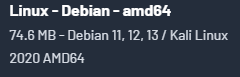

Tras la instalación, Nessus necesita compilar su base de datos de plugins antes de quedar operativo — este paso tomó cerca de 20 minutos y bloquea la creación de scans hasta terminar:

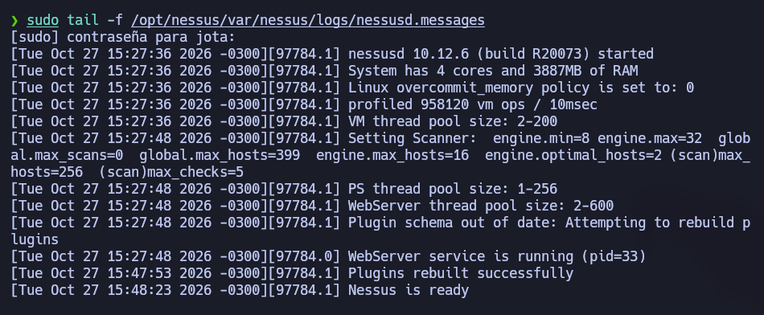

### Configuración del scan

Nessus ofrece varios templates de scan según el objetivo (Basic Network Scan, Web Application Tests, Host Discovery, Credentialed Patch Audit, entre otros). Para esta evaluación se usó un **Basic Network Scan** configurado manualmente:

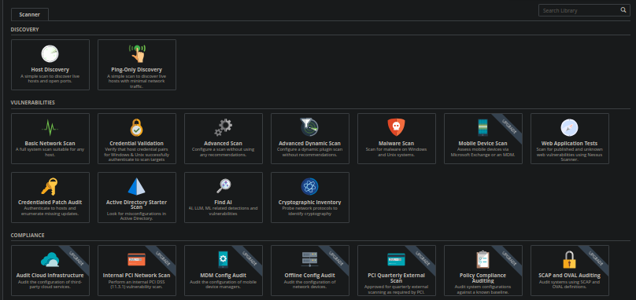

- **DISCOVERY → Port scan:** configurado en *"Port scan (all ports)"* en vez del rango reducido por defecto, para no dejar fuera servicios en puertos no estándar
- **ADVANCED → Scan low bandwidth links:** activado, ya que el tráfico del scan viaja a través de la VPN de TryHackMe (un enlace de menor ancho de banda que una red local), evitando falsos negativos por timeouts prematuros

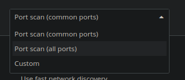

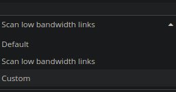

### Hallazgos

El scan identificó, entre otros:

- **Nessus SYN scanner (#11219)** — confirma el método de descubrimiento de puertos usado por el propio Nessus (hallazgo informativo, no una vulnerabilidad)
- **HTTP Server Type and Version (#10107)** — `Apache/2.4.41 (Ubuntu)`, disclosure de versión del servidor web

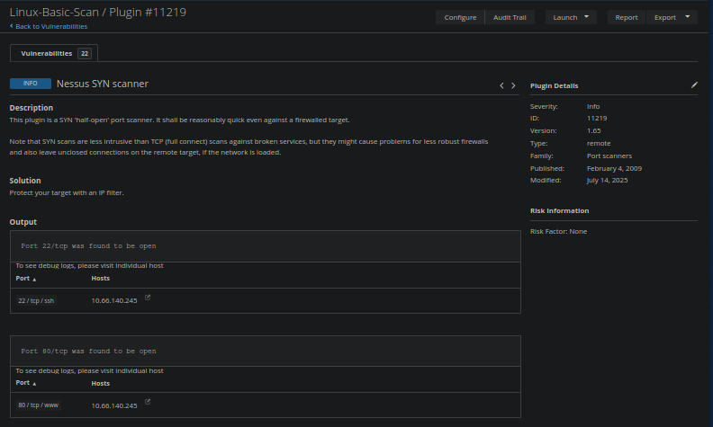

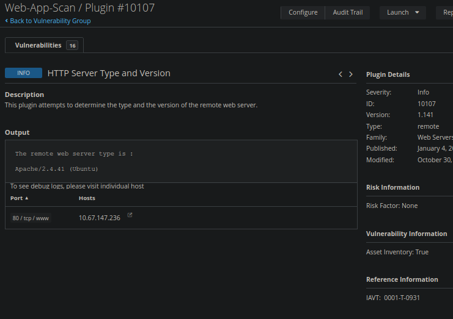

El scan completo contra la aplicación web objetivo cerró con 3 hallazgos Medium y 19 Info:

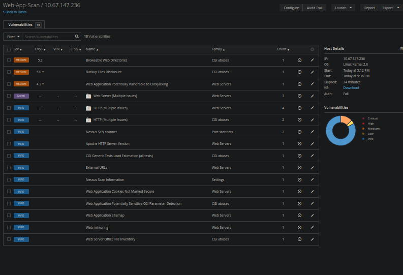

Y los hallazgos principales de severidad media-baja:

| Hallazgo | Plugin ID | Descripción |
|---|---|---|
| Browsable Web Directories | #40984 | Directorios del servidor listables sin control de acceso |
| Backup Files Disclosure | #11411 | Archivos `.bak` accesibles públicamente, potencialmente con código fuente u otras credenciales |
| Clickjacking | #85582 | Falta el header `X-Frame-Options`, el sitio puede embeberse en un iframe malicioso |
| Cleartext Credentials | #26194 | Credenciales transmitidas sin cifrado |
| HTTP Server Type and Version | #10107 | Disclosure de versión (Apache/Ubuntu) |

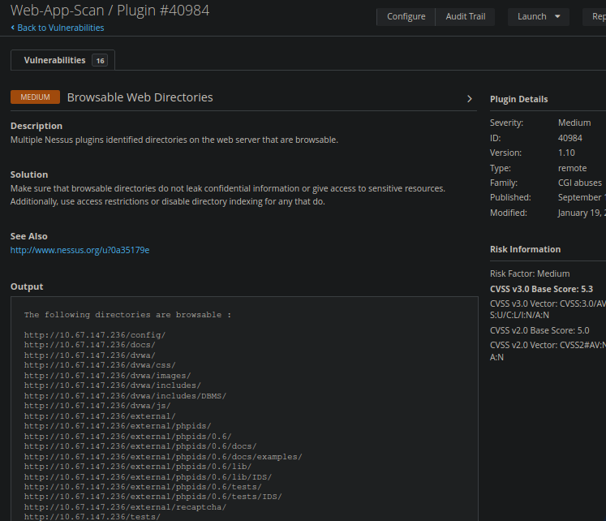

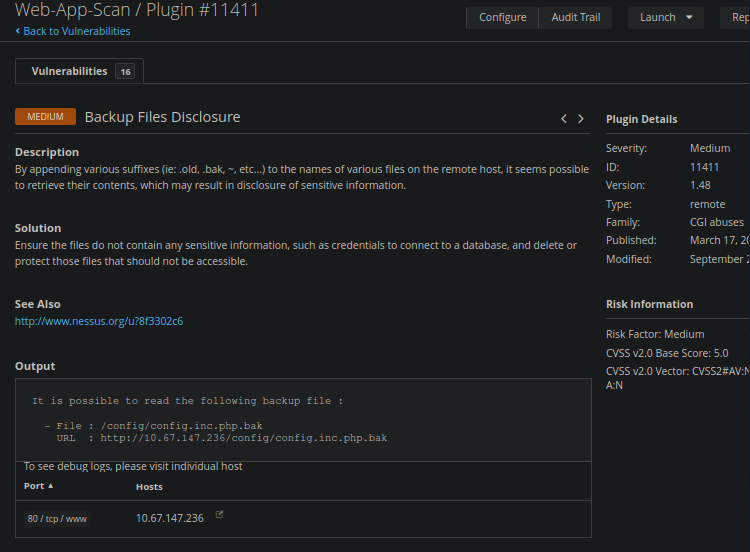

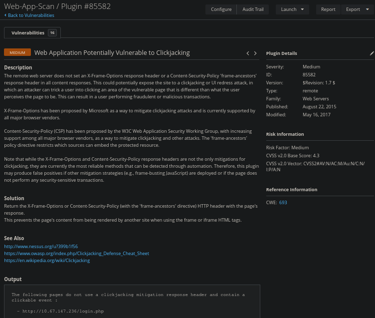

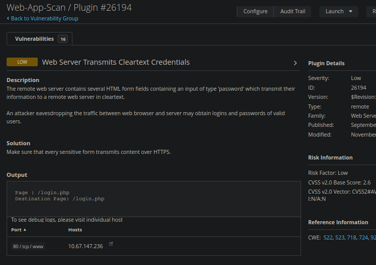

---

## OpenVAS

### Arquitectura e instalación

OpenVAS/GVM se compone de tres capas: el **Front-End** (GSA, la interfaz web), el **Back-End** (OSP + el motor scanner + los targets) y el **Feed** de inteligencia (NVTs y SCAP, actualizados constantemente con nuevas firmas de detección).

Se instaló vía Docker (imagen `mikesplain/openvas`) sobre Parrot. Esto implicó un obstáculo real de entorno: Parrot trae por defecto **`podman-docker`** (una capa de compatibilidad de Podman que imita la CLI de Docker) en vez de Docker Engine real, y el paquete `docker.io` ni siquiera tiene un candidato instalable en los repositorios propios de Parrot.

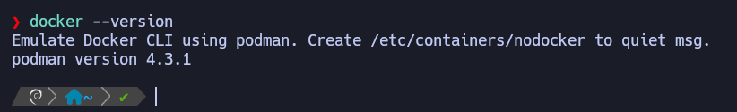

La solución fue agregar el repositorio oficial de Docker (fijando manualmente el codename `bookworm`, ya que Parrot 6.x "Lorikeet" está basado en Debian 12 pero su propio codename no es reconocido por el repo de Docker) e instalar Docker CE real. El detalle completo de este troubleshooting está en la sección "Lo que probé y no funcionó".

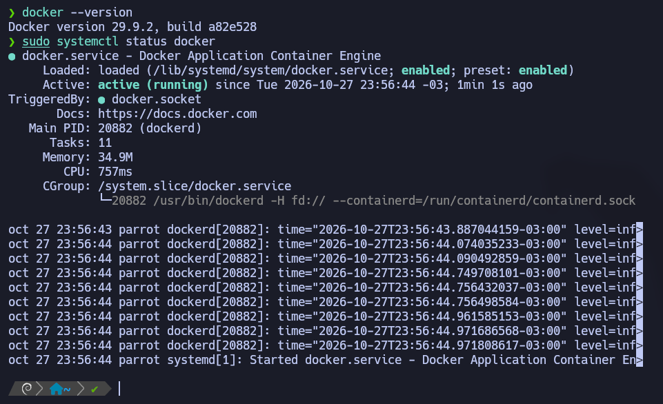

```bash
docker run -d -p 443:443 --name openvas mikesplain/openvas
docker ps
```

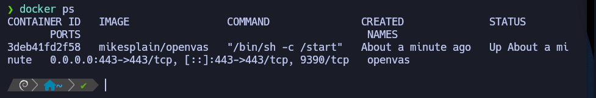

### Validación inicial

Acceso al panel (Greenbone Security Assistant) con las credenciales por defecto:

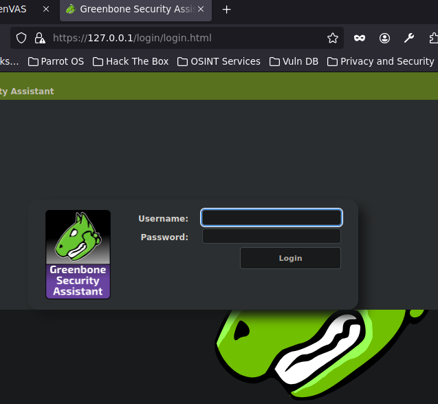

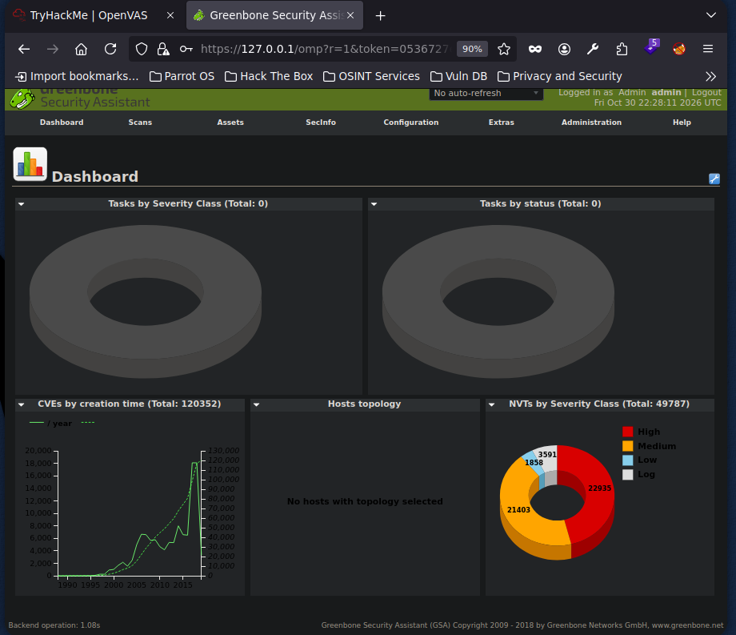

Antes de escanear un objetivo real, se corrió un scan contra `127.0.0.1` (la propia instalación) para confirmar que el feed de NVTs, el motor y el reporting funcionan correctamente de punta a punta:

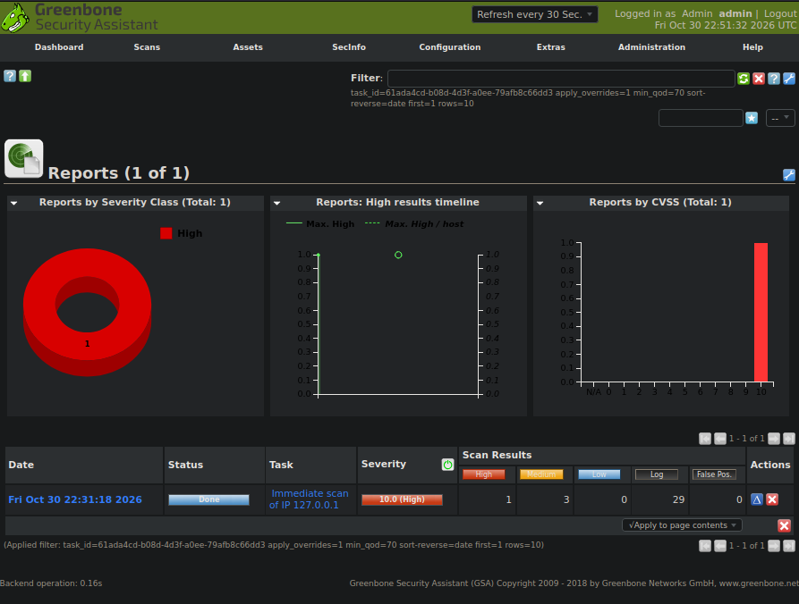

Los 4 hallazgos son, en su mayoría, esperables al escanear el propio contenedor:

| Hallazgo | Severidad | Puerto |
|---|---|---|
| OpenVAS/GVM Default Credentials | 10.0 (High) | 9390/tcp |
| SSL/TLS: Certificate Expired | 5.0 (Medium) | 443/tcp |
| SSL/TLS: Certificate Expired | 5.0 (Medium) | 9390/tcp |
| Mailserver responde a VRFY/EXPN | 5.0 (Medium) | 25/tcp |

El más relevante es el primero: el puerto 9390 es el protocolo de gestión interno (GMP), y usar las credenciales por defecto (`admin`/`admin`) ahí es, correctamente, un hallazgo crítico — en un despliegue real, ese puerto jamás debería quedar con credenciales default.

### Escaneo de infraestructura real: DVWA

Con la instalación validada, se configuró un Target (`DVWA`) apuntando a una instancia de DVWA desplegada en la room, y se lanzó un scan completo (`Full and fast`):

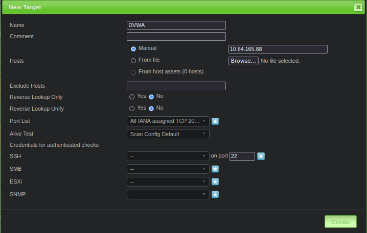

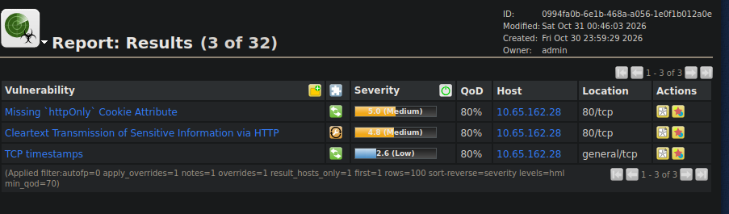

| Hallazgo | Severidad | Puerto |
|---|---|---|
| Missing `httpOnly` Cookie Attribute | 3.0 (Medium) | 80/tcp |
| Cleartext Transmission of Sensitive Information via HTTP | 4.8 (Medium) | 80/tcp |
| TCP timestamps | 2.6 (Low) | general/tcp |

Un hallazgo conceptual importante acá: DVWA está diseñado con vulnerabilidades de **lógica de aplicación** (SQL injection, XSS, CSRF), y un scanner de infraestructura como OpenVAS **no las detecta** — no son su dominio. OpenVAS encuentra bien configuraciones de red/transporte (cookies, cifrado, metadata TCP), pero vulnerabilidades a nivel de código requieren herramientas de análisis dinámico de aplicaciones web (Burp Suite, por ejemplo — siguiente fase de mi roadmap). Es la prueba práctica de que ninguna herramienta cubre todo el espectro por sí sola.

### Reporting y monitoreo continuo

OpenVAS permite automatizar reescaneos (**Schedules**) y notificaciones (**Alerts**), asociándolos a una Task existente:

- **Schedule** `Weekly DVWA Rescan` — cadencia semanal, para monitoreo continuo en vez de un scan puntual
- **Alert** `Notify on Scan Complete` — evento "Task run status changed to Done", condición "Severity at least 7" (para evitar saturar la bandeja con notificaciones de hallazgos triviales), método Email

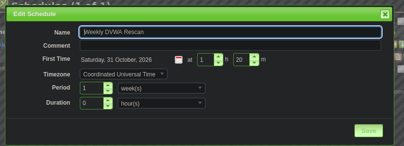

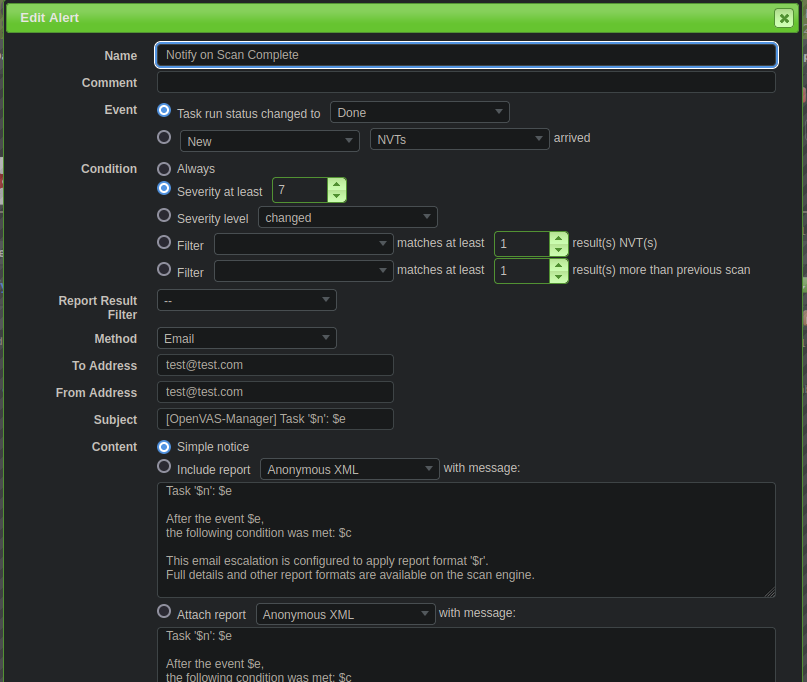

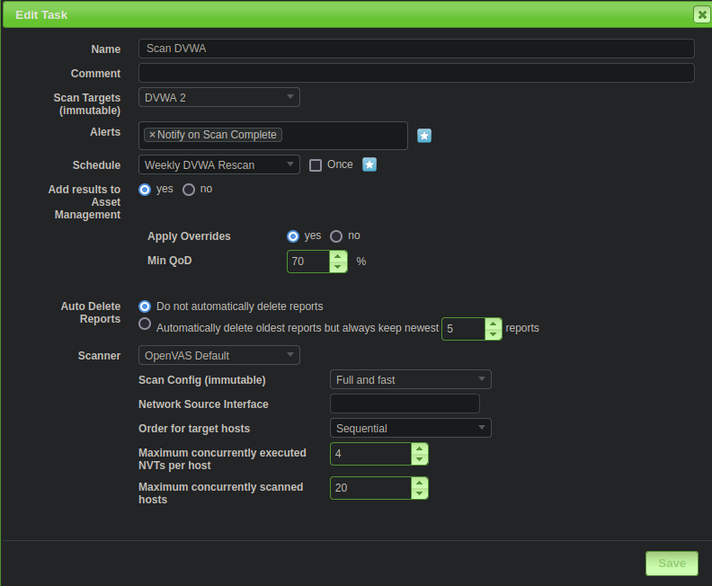

Detalle técnico relevante: una vez que una Task tiene reportes generados, GVM bloquea la edición de su **Target** y **Scan Config** (quedan marcados "immutable") para no corromper el historial — pero **Alerts** y **Schedule** sí se pueden seguir editando libremente, porque no afectan la integridad de resultados pasados.

### Caso práctico: "MS00-What?"

Ejercicio tipo SOC analyst: interpretar un reporte ya generado (sin correr el scan) para extraer información operativa.

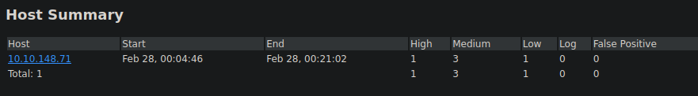

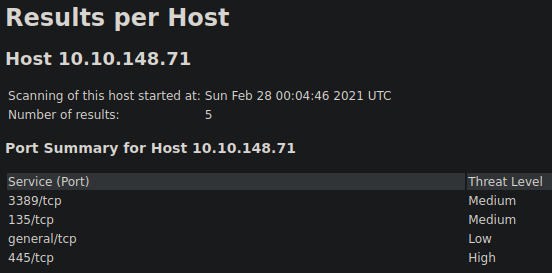

| Dato | Valor |
|---|---|
| Inicio del scan | Feb 28, 00:04:46 |
| Fin del scan | Feb 28, 00:21:02 |
| Puertos abiertos | 3 (3389, 135, 445) |
| Vulnerabilidades totales | 5 |
| Vulnerabilidad de mayor severidad | **MS17-010** (CVSS 9.3, puerto 445/tcp) |
| Primer SO afectado listado | Microsoft Windows 10 x32/x64 Edition |
| Método de detección | Envío de un SMB transaction request manipulado (fid = 0), verificando la respuesta |

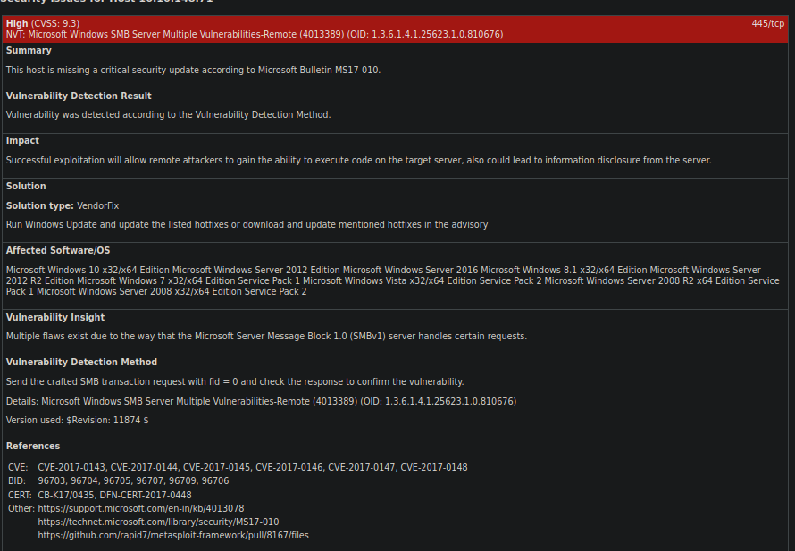

**MS17-010** es la vulnerabilidad de SMBv1 detrás de EternalBlue/WannaCry — un ejemplo real de **CVSS alto + explotabilidad masiva en el mundo real (equivalente a un EPSS altísimo)**, exactamente el tipo de hallazgo que un motor de priorización bien diseñado debería poner en el tope de cualquier lista de remediación.

---

## Vulnerability Scanning Tools (Nmap + Nikto)

### Reconocimiento con Nmap

Metodología en tres pasos, de menos a más intrusivo:

```bash
nmap -sn <IP>              # Host discovery — ¿está vivo?
nmap -sV <IP>               # Port scan + detección de versión de servicio
nmap -A <IP>                 # Scan agresivo: OS detection, traceroute, NSE default
```


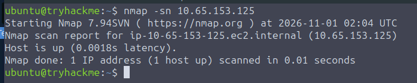

El scan de versión reveló 5 servicios:

```
21/tcp   open  ftp     vsftpd 3.0.5
22/tcp   open  ssh     OpenSSH 9.6p1 Ubuntu 3ubuntu13.11
80/tcp   open  http    WebSockify Python/3.12.3
5901/tcp open  vnc     VNC (protocol 3.8)
8080/tcp open  http    Apache httpd 2.4.58 (Ubuntu)
```

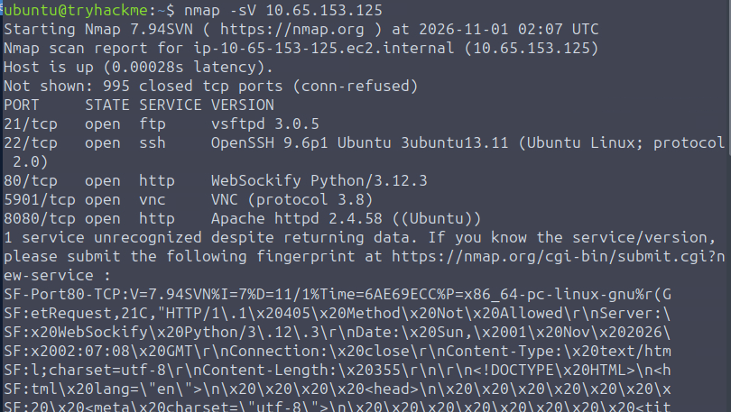

El scan agresivo (`-A`), al incluir el set por defecto de scripts NSE, adelantó varios hallazgos relevantes automáticamente:

- **`ftp-anon`**: login FTP anónimo permitido (código 230) — control y datos del FTP viajan en texto plano
- **`http-cookie-flags`**: la cookie `PHPSESSID` del servicio en el puerto 8080 se crea sin el flag `httponly`
- **VNC expuesto** (puerto 5901) con autenticación clásica disponible — superficie de ataque de acceso remoto a escritorio

El `-A` incluye por defecto el set "default" de scripts NSE (`ftp-syst`, `ftp-anon`, `ssh-hostkey`, `http-cookie-flags`, `vnc-info`, entre otros) — cada bloque adicional debajo de un puerto en el output es literalmente el resultado de uno de estos scripts corriendo automático.

### NSE dirigido

Para confirmar un hallazgo puntual sin repetir el reconocimiento completo, se corrió el script NSE de forma aislada:

```bash
nmap --script=ftp-anon -p21 <IP>
```

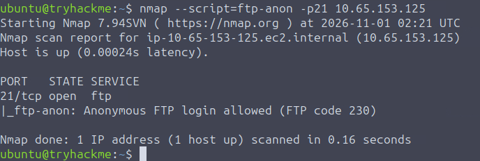

Mismo resultado que dentro del `-A` (login anónimo confirmado), pero en **0.16 segundos** contra los ~80 segundos del scan agresivo completo — la ventaja práctica de apuntar un NSE específico cuando ya se sabe qué se busca.

### Escaneo web con Nikto

Contra el servicio Apache del puerto 8080 (una aplicación ficticia, "AtlasNews"):

```bash
nikto -h http://<IP>:8080
```

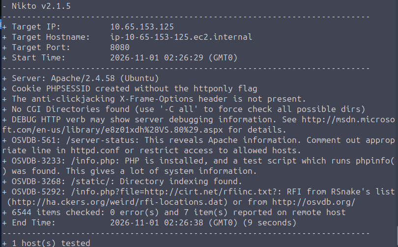

| Hallazgo | Riesgo |
|---|---|
| `Server: Apache/2.4.58 (Ubuntu)` | Disclosure de versión exacta del software |
| Cookie `PHPSESSID` sin flag `httponly` | Cookie de sesión robable vía XSS |
| Header `X-Frame-Options` ausente | Sitio vulnerable a clickjacking |
| Método HTTP `DEBUG` habilitado | Posible filtración de info de depuración del servidor |
| `/server-status` accesible | Expone conexiones activas e IPs de clientes |
| `/info.php` (phpinfo) accesible | Expone configuración completa de PHP y del servidor |
| `/static/` con directory indexing | Contenido del directorio listado públicamente |
| `info.php?file=...` vulnerable a RFI | El parámetro `file` acepta una URL externa sin validar — potencial ejecución remota de código |

El hallazgo de **RFI (Remote File Inclusion)** es el más crítico: si el backend PHP no sanitiza el parámetro `file`, un atacante podría forzar al servidor a incluir y ejecutar código alojado en cualquier sitio externo.

### OpenVAS pre-instalado (reporte "MyTarget")

Esta room trae una segunda instancia de OpenVAS ya configurada (puerto 9392, distinta de la instalación propia hecha en la room anterior), con un scan pre-generado para análisis directo sin necesidad de conexión a internet para sincronizar el feed:

| Hallazgo | Severidad | CVE |
|---|---|---|
| Anonymous FTP Login Reporting | 6.4 (Medium) | CVE-1999-0497 |
| phpinfo() Output Reporting (HTTP) | 5.3 (Medium) | CVE-2008-0149, CVE-2023-49282, CVE-2023-49283, CVE-2024-10486 |
| ICMP Timestamp Reply Information Disclosure | 2.1 (Low) | CVE-1999-0524 |

**Sistema operativo del target:** Ubuntu 24.04 (`cpe:/o:canonical:ubuntu_linux:24.04`)

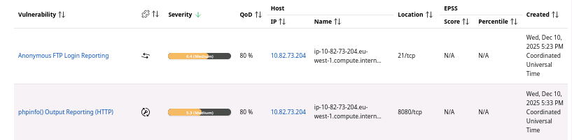

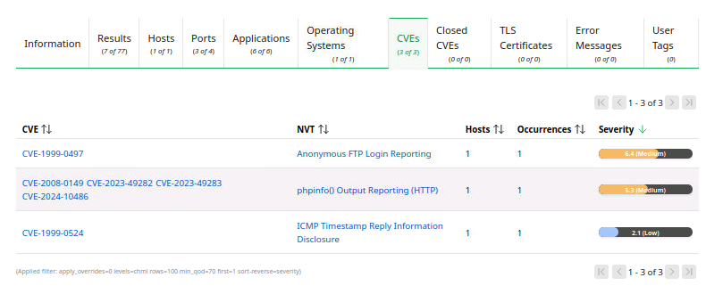

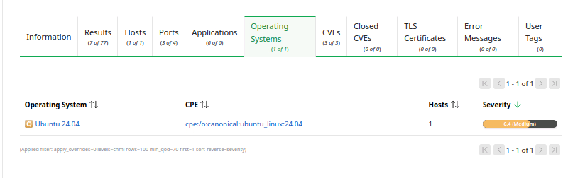

Estos resultados coinciden exactamente con lo que ya había encontrado Nmap (FTP anónimo) y Nikto (phpinfo expuesto) de forma independiente — una buena confirmación cruzada de que los hallazgos son reales y no ruido de una sola herramienta.

---

## Lo que probé y no funcionó

**`nessuscli` no encontrado en PATH:** Al intentar correr `sudo nessuscli update` para forzar la recompilación de plugins, el comando devolvió "command not found" — el binario no está en el PATH por defecto. Se ubicó con `sudo find /opt/nessus -name "nessuscli"` y se ejecutó con la ruta completa (`/opt/nessus/sbin/nessuscli update`), lo que sí resolvió el problema de plugins atascados.

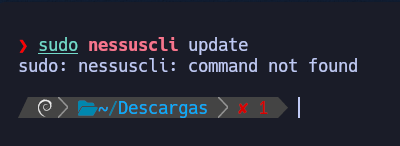

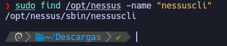

**Docker vs. Podman en Parrot (instalación de OpenVAS):** Parrot trae `podman-docker` preinstalado, que imita la CLI de Docker pero no es Docker real.


El primer intento de instalar `docker.io` directo falló porque ese paquete no tiene candidato instalable en los repos propios de Parrot — es solo un paquete virtual provisto por `podman-docker`. Hubo que agregar el repositorio oficial de Docker, fijando manualmente el codename `bookworm` (la base Debian real de Parrot, ya que su propio codename `lory`/`lorikeet` no es reconocido por el repo de Docker). Incluso después de eso, `docker-ce-cli` falló al intentar sobreescribir `/usr/bin/docker`, porque `podman-docker` seguía instalado (un intento previo de removerlo había fallado silenciosamente por un conflicto de dependencias no relacionado):

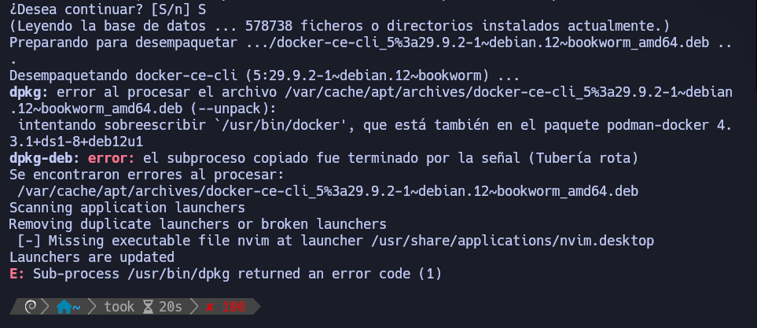

La solución final fue una transacción combinada de apt con overwrite forzado, que instaló Docker real y removió `podman-docker` en el mismo paso:

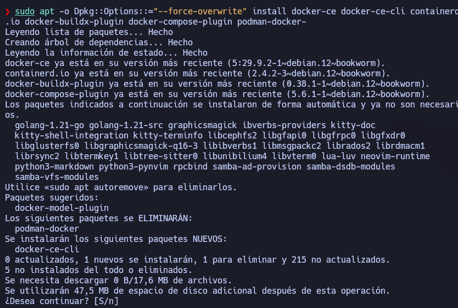

**Target/Scan Config inmutables tras generar reportes:** Al intentar reapuntar la Task "Scan DVWA" a una IP nueva (la máquina de la room había expirado y se redesplegó con otra IP), GVM no permitió editar el Target directamente — una vez que una Task tiene reportes asociados, el Target y el Scan Config quedan bloqueados ("immutable") para preservar la integridad histórica. La solución fue crear un Target nuevo y reasignarlo desde el dropdown de la propia Task (que sí permite seleccionar un target distinto, aunque no editar el existente).

**Consumo de recursos de la VM:** Correr Nessus, Docker/OpenVAS y Firefox simultáneamente en una VM con 4 GB de RAM asignados causó "thrashing" (swapping extremo, comandos tardando minutos en ejecutarse). Se resolvió subiendo la memoria asignada a la VM a 6 GB y liberando el servicio de Nessus en background (`systemctl stop nessusd`) cuando no estaba en uso activo — una lección práctica sobre dimensionar recursos al correr varias herramientas de seguridad en paralelo.

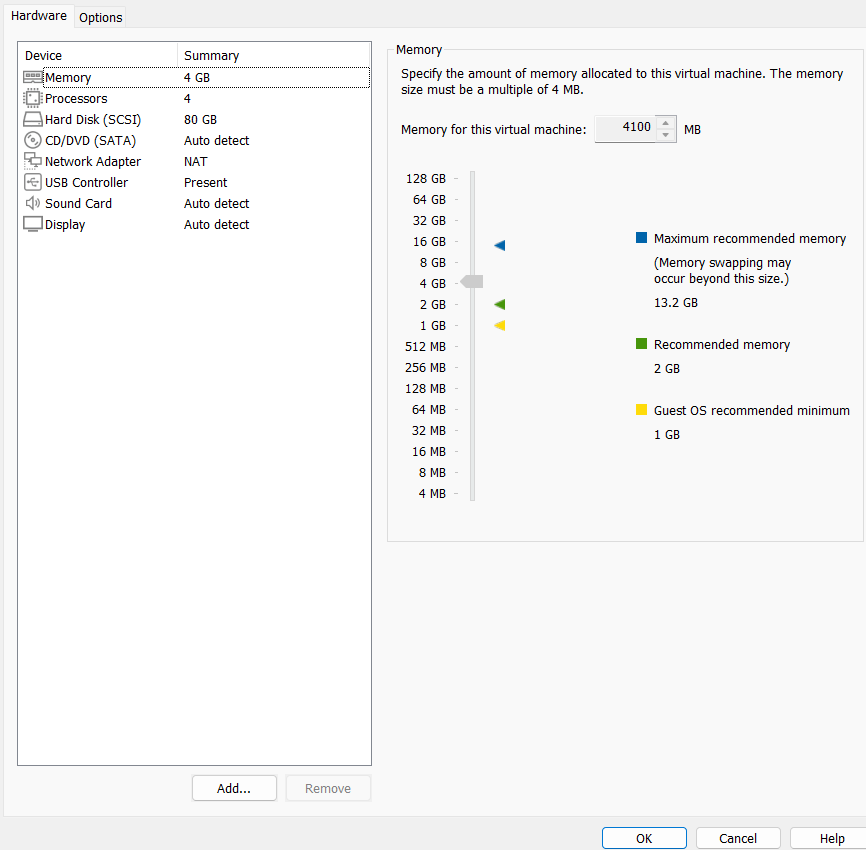

---

## Impacto

Ninguno de los hallazgos de esta fase es, por sí solo, una toma de control inmediata del sistema — pero en conjunto dibujan un panorama de riesgo real:

- **MS17-010** es la vulnerabilidad más seria encontrada: explotada activamente en el mundo real por EternalBlue/WannaCry, permite ejecución remota de código sin autenticación contra sistemas Windows sin parchar.
- **RFI en AtlasNews** permitiría, si el parámetro no está sanitizado, ejecución remota de código arbitrario cargado desde un servidor externo.
- **FTP anónimo + credenciales en texto plano** (Nessus, DVWA, AtlasNews) facilitan intercepción de credenciales y acceso no autorizado a archivos.
- **Credenciales por defecto en el propio OpenVAS** (puerto 9390) demuestran que incluso las herramientas de seguridad necesitan hardening post-instalación.
- **Exposición de información de diagnóstico** (phpinfo, server-status, versiones de software) no compromete un sistema por sí sola, pero reduce drásticamente el esfuerzo de reconocimiento de un atacante — es la diferencia entre un ataque dirigido y uno de fuerza bruta a ciegas.

---

## Perspectiva defensiva

**Gestión de parches:**
- MS17-010 tiene parche disponible desde 2017 — un sistema vulnerable hoy indica ausencia de política de actualización. Habilitar Windows Update o gestión centralizada de parches (WSUS) es la mitigación directa.

**Configuración de servidores web:**
- Deshabilitar `directory indexing` en producción; servir siempre un índice explícito.
- Remover archivos de diagnóstico (`phpinfo.php`, `/server-status`) antes de pasar a producción.
- Agregar headers de seguridad faltantes: `X-Frame-Options`, `Content-Security-Policy`.
- Setear el flag `HttpOnly` (y `Secure`) en todas las cookies de sesión.
- Validar/sanitizar cualquier parámetro que reciba una ruta o URL como input (mitigación directa de RFI) — nunca confiar en input del usuario para construir rutas de inclusión de archivos.

**Autenticación y servicios expuestos:**
- Deshabilitar login FTP anónimo salvo que sea estrictamente necesario; preferir SFTP/FTPS.
- Restringir acceso a VNC solo a redes de confianza (VPN), nunca expuesto directo a internet, y usar autenticación robusta (no la clásica VNC Authentication).
- Cambiar credenciales por defecto de cualquier herramienta de gestión (incluyendo scanners de seguridad) inmediatamente tras la instalación.

**Gestión de vulnerabilidades como proceso continuo:**
- Automatizar reescaneos periódicos (Schedules) en vez de scans puntuales — las vulnerabilidades y el inventario de activos cambian constantemente.
- Configurar alertas filtradas por severidad para evitar fatiga de notificaciones.
- Usar múltiples herramientas complementarias: un scanner de infraestructura (Nessus/OpenVAS) no reemplaza un scanner de aplicación web (Nikto) ni un análisis dinámico de lógica de negocio (Burp Suite, próxima fase).

---

## Conclusión

Esta fase confirmó algo que se intuye en la teoría pero se aprende de verdad en la práctica: **ninguna herramienta de escaneo cubre todo el espectro de vulnerabilidades**. Nessus y OpenVAS son excelentes para infraestructura y configuración de red/transporte; Nikto se especializa en el servidor web; Nmap con NSE es el punto de partida de todo reconocimiento y además puede hacer pruebas puntuales de vulnerabilidad; y ninguno de los tres detecta vulnerabilidades de lógica de aplicación (SQLi, XSS) como las que DVWA está diseñado para exponer — eso requiere una categoría de herramienta distinta, que es justamente el enfoque de la siguiente fase de mi roadmap (OWASP Top 10 + Burp Suite).

A nivel operativo, también quedó claro que gran parte del trabajo real de seguridad no es correr el scanner, sino **hacer que el scanner funcione** en el entorno real: pelear con gestores de paquetes, resolver conflictos de dependencias, dimensionar recursos de VM, y lidiar con el estado de las herramientas (targets inmutables, feeds sincronizando). Esa fricción de entorno es tan parte del trabajo de un analista de seguridad como interpretar un reporte de CVSS.
